

**Твоя коллекция. Твои вселенные.**

Аниме, к которым хочется возвращаться: личные тиры, даты сезонов,
календарь, **3D-спираль коллекции**, **138 стикеров персонажей**, **50 ботанических рамок**
учёт времени просмотра и коллекционные открытки.

[**Открыть сайт ↗**](https://geraltschwarzenegger-svg.github.io/myTierAnime/?v=4.2.0)
&nbsp; · &nbsp; [Скачать офлайн-версию](https://raw.githubusercontent.com/geraltschwarzenegger-svg/myTierAnime/main/NEWAnime%20tier%20list11-08-2026.html)
&nbsp; · &nbsp; [Резервная коллекция](anime-tierlist-2026-10-11.json)

---

## Что нового на сайте (Changelog)

### V4.2.0 · Спираль памяти · 23 октября 2026

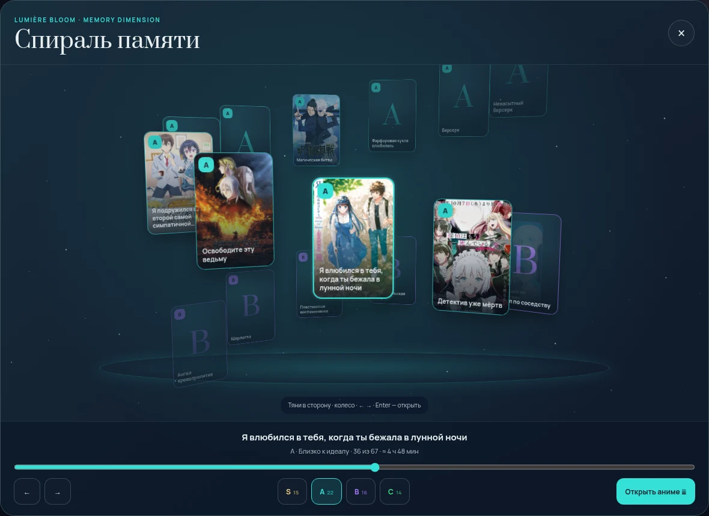

**Вся коллекция — в отдельной интерактивной 3D-сцене.** Кнопка
**«Спираль памяти»** находится рядом с ателье рамок. Постеры, чипы,
даты, стикеры и расчёт времени продолжают работать вместе с новым режимом.

| Новое | Как работает |
|:---|:---|
| **Объёмная спираль** | Перелистывай перетаскиванием, колесом, стрелками или ползунком. Home / End — начало и конец, Page Up / Down — по пять аниме, Enter — открыть выбранное. |
| **Касания без конфликтов** | Нажатие выбирает постер; горизонтальный жест вращает сцену. Перетаскивание не превращается в случайное нажатие. |
| **Быстрые переходы** | Кнопки тиров показывают количество аниме и переходят к началу категории. Поддерживаются собственные тиры, названия и цвета. |
| **Знакомая карточка** | «Открыть аниме» возвращает к постеру или чипу и открывает обычный `#preview` со стикерами, сезонами и временем. Если фильтры скрывают аниме, они сбрасываются с пояснением. |
| **Свет в цвет тира** | S — золото, A — бирюза, B — сирень, C — мята. Пользовательские цвета также подхватываются. Подсветка постеров использует существующий механизм наклона, без второго обработчика движения. |
| **Настройки движения** | «Без движения» отключает наклон и инерцию; перелистывание остаётся доступным. Учитываются системное reduced motion и ручной выбор сайта. |
| **Ограниченная отрисовка** | На компьютере в DOM до 17 ближайших постеров, на телефоне и в лёгком режиме — до 9. Сцена неподвижна в ожидании ввода; после закрытия обложки и кадры освобождаются. |
| **Данные остаются твоими** | Спираль читает коллекцию из `state` и работает в режиме чипов. Добавления, удаления и перерисовки обновляют сцену, сохраняя выбранный UID, если он ещё существует. JSON, даты, реакции и время от навигации не меняются. |
| **PNG совместим** | Перед захватом спираль закрывается, свет и наклон сбрасываются. Обычный PNG коллекции и открытка сохраняют прежний формат. |

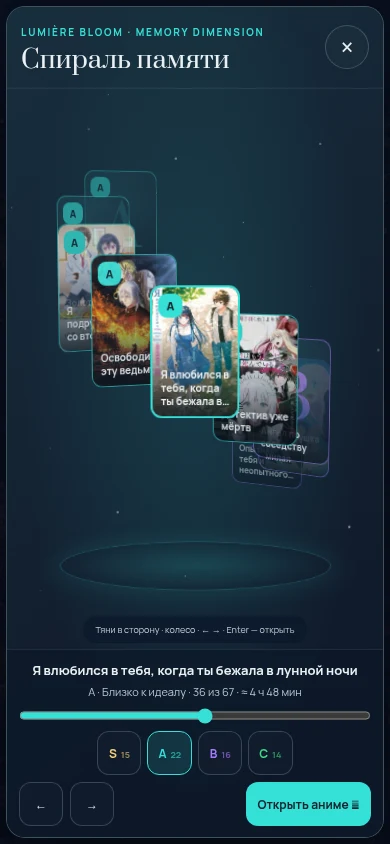

Если внешняя обложка не загрузилась, остаются название и знак тира.
Новые библиотеки, WebGL и дополнительные аккаунты для спирали не нужны.

### V4.1.0 · Время в любимых мирах · 21 октября 2026

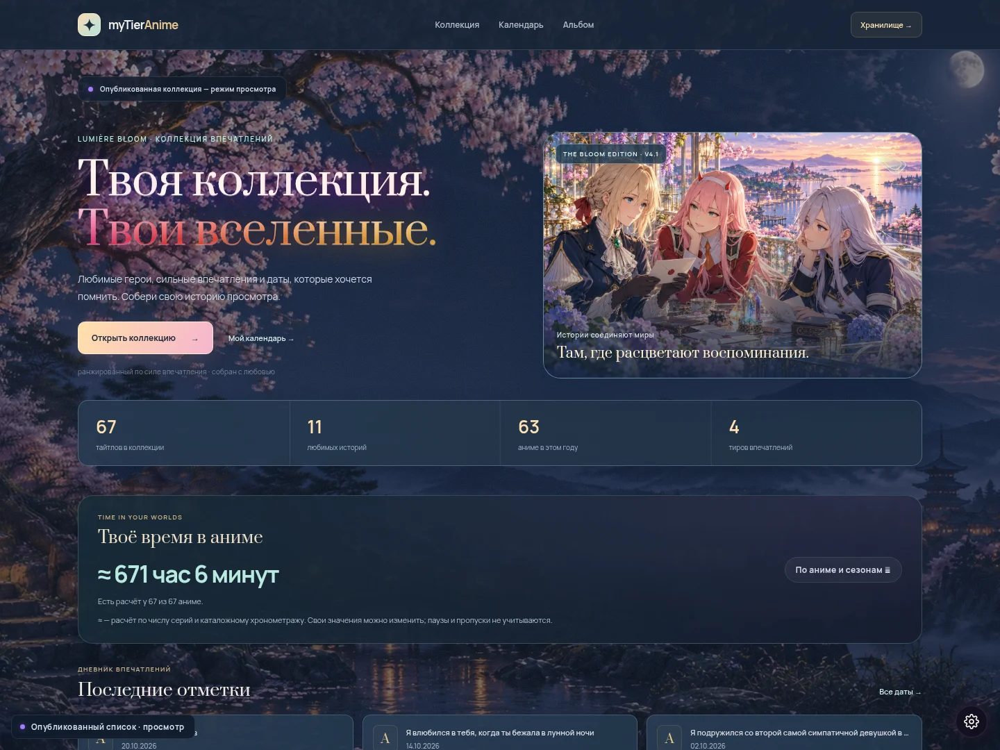

**≈ 671 час 6 минут** по текущему объёму коллекции. Число пересчитывается
при изменении серий или ручного времени, без обращения к внешним API.

| Обновление | Как работает |
|:---|:---|
| **Время рядом с сезоном** | В раскрытой карточке и календаре показаны часы и минуты каждой записи. Для аниме доступен собственный итог. |
| **Каталог для всех 67 аниме** | Проверены 124 основные части: сезоны и сюжетные фильмы. У каждой — число серий, хронометраж, формула и ссылка на источник. |
| **Свой ввод** | Выбери «Серии × минуты» или «Часы и минуты». Например, 4 часа 23 минуты сохраняются как 263 минуты. |
| **Общий итог без дублей** | Общая длительность аниме заменяет сумму дат. Пересказ фильма и уже учтённые серии не складываются автоматически. |
| **Сохранение и импорт** | Время входит в оба JSON, localStorage, IndexedDB и подключённый файл. Импорт замечает даже изменение только времени. Старые файлы совместимы. |
| **Прозрачная оценка** | Знак ≈ обозначает расчёт по каталожным длительностям. Неуказанное время остаётся неизвестным; ручной ноль сохраняется. |

[Все источники, части и расчёты →](docs/watchtime-sources.md) ·
[Каталог времени JSON](assets/catalog/watchtime.json)

### Коллекция · 20 октября 2026

Добавлен **«Детектив уже мёртв»** в тир **A**: **1 сезон · 12 серий**,
просмотрен **20.10.2026**. Использована выбранная владельцем обложка Shikimori;
её копия хранится в проекте. Оба JSON синхронизированы: **67 аниме**,
**77 записей просмотра**, **22 тайтла в A**. Остальная коллекция сохранена.

### V4.0.0 · Lumière Bloom · 18 октября 2026

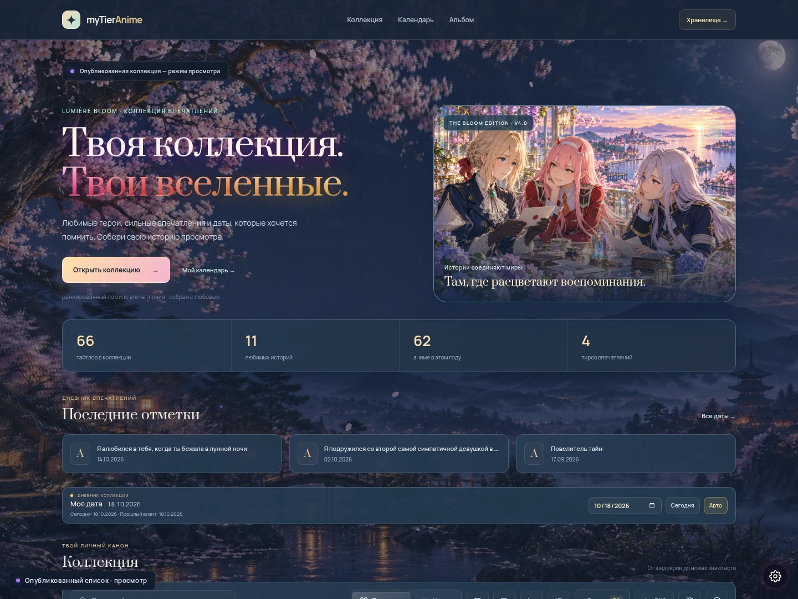

**Коллекция стала ярче, а оформление — легче.** Новые иллюстрации, розовое
золото, бирюза, жемчужный свет и цветочные узоры объединены в одну тему.
Изображения подготовлены специально для проекта; персонажи представлены
в виде неофициального фан-арта.

| Обновление | Что изменилось |
|:---|:---|
| **Новая главная** | Иллюстрация оранжереи над озером сакуры: Вайолет, Зеро Ту и Лена. Светлее поверхности, контрастнее текст, новый заголовок и золотисто-розовая кнопка коллекции. |
| **138 стикеров · 19 аниме** | Прежний набор котиков заменён персонажами. Добавлены **48 новых стикеров**: «Песнь ночных сов», «Фарфоровая кукла влюбилась», «Ангел по соседству» и «Магическая битва» — по 12. Сохранены 90 вариантов по всем 15 аниме S-тира. |
| **По стикеру каждому** | На всех **66 постерах — разные декоративные стикеры**. Они крупнее и расположены над названием. Украшение хранится отдельно от впечатления: твои прежние оценки, реакции и избранное сохранены. |
| **Персонажи на плашках** | Свободное место S-тира занимают Вайолет, Зеро Ту и Лена. У остальных тиров — отдельные акценты. На узком экране остаётся по одному персонажу, чтобы плашки не перегружались. |
| **50 новых рамок** | Все модели переработаны: камелии, орхидеи, гортензии, лилии, листья, эмаль, жемчуг и огранённые камни. Открытый центр сохраняет читаемость постера. |
| **Новые 3D-композиции** | Солнечный кристалл, голографическая призма, спектральная лента и цветок света. У постеров — локальный наклон и короткий блик на рамке при взаимодействии. |
| **Открытка аниме** | Новая кнопка в раскрытой карточке. Персонаж, название, тир и даты просмотра собираются в **PNG 960 × 1440**. Три атмосферы: розовое золото, лунная лагуна и аметистовый вечер. |
| **Плавность: Авто / Детали / Лёгкий** | Автоматический режим оценивает скорость отрисовки и выбирает облегчённое оформление на слабых устройствах. Режим можно сменить вручную; выбор сохраняется. |
| **Меньше лишней работы** | Один SVG на рамку вместо восьми. Убраны постоянно бегущие контуры и движение большой фоновой ветки; глубина и свет остались в небольших локальных композициях. |
| **Вне экрана — пауза** | Видимость отслеживается у самой 3D-эмблемы, а не у всей длинной секции. Невидимые секции браузер может пропускать при отрисовке; обложки и альбом загружаются лениво. |
| **Сохранения совместимы** | Старые ключи реакций продолжают работать и показывают новые изображения персонажей. Даты, сезоны, тиры, избранное и выбранные обложки не переписаны. Оба JSON синхронизированы. |

[Иллюстрация главной](assets/art/bloom-conservatory.webp) · [Полная иллюстрация баннера](docs/images/bloom-keyvisual.webp)

### Измеримые изменения

| Показатель | До | V4.0 | Изменение |
|:---|---:|---:|---:|
| Текущие стикеры | 102 | **138** | **+35,3%** |
| Наборы по аниме | 15 | **19** | **+26,7%** |
| Новые иллюстрации стикеров | — | **48** | 4 набора × 12 |
| Разные украшения на постерах | — | **66** | вся коллекция |
| SVG внутри 66 рамок | 528 | **66** | **−87,5%** |
| Элементы внутри рамок | 16 183 | **4 172** | **−74,2%** |

Это показатели содержимого и структуры интерфейса. Они не означают одинаковый
прирост FPS на всех устройствах: скорость зависит также от браузера, графики
и размера экрана. [Подробности оптимизации](docs/performance-v4.md).

## Персонажи и впечатления

<table><tr>
<td width="50%">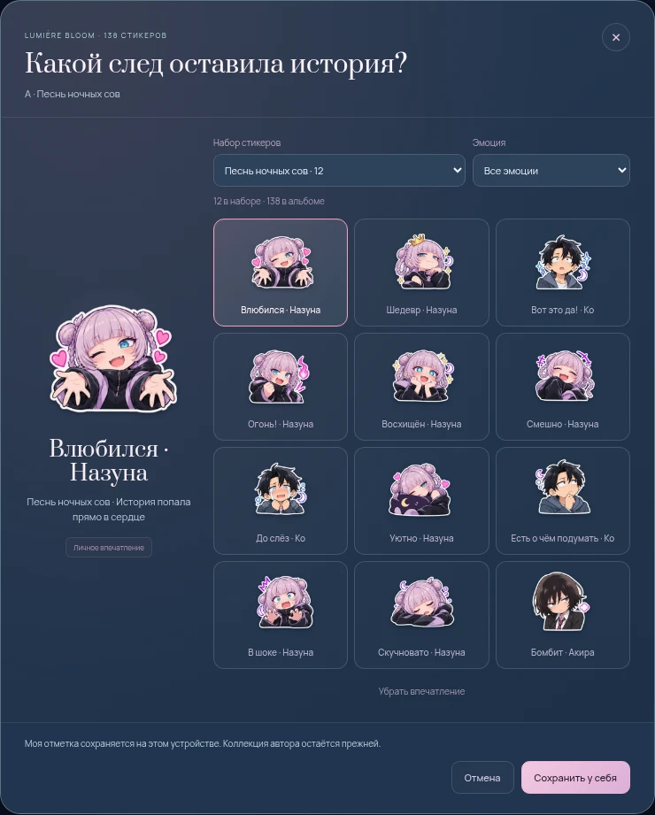 Назуна, Ко и Акира · Песнь ночных сов</td>
<td width="50%">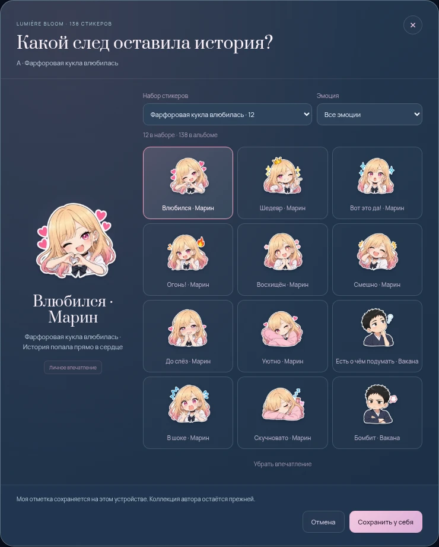 Марин и Вакана · Фарфоровая кукла влюбилась</td>
</tr></table>

**Как выбрать впечатление:** нажми на аниме → открой блок реакции под обложкой →
выбери набор и эмоцию → сохрани. Доступны 12 настроений: любовь, шедевр,
удивление, огонь, восхищение, смех, слёзы, уют, размышление, шок, скука и злость.
У каждого S-набора шесть вариантов; у четырёх новых — по двенадцать.

**Декоративный стикер и реакция — разные данные.** Стикер украшает постер;
впечатление выражает твоё отношение к просмотру. Автоматическое распределение
персонажей не назначает тебе новые оценки. Когда выбираешь новую реакцию,
её персонаж появляется на твоём постере.

Карта впечатлений над тирами объединяет реакции по смыслу: «До слёз» найдёт
все такие отметки, независимо от персонажа. Поиск, избранное и кнопка
**«Случайное воспоминание»** работают вместе с выбранным настроением.

<b>Все 19 аниме-наборов</b>

| Наборы S-тира · по 6 | Новые наборы · по 12 |
|:---|:---|
| Violet Evergarden · Атака титанов · Класс превосходства | **Песнь ночных сов** — Назуна, Ко, Акира |
| Человек-бензопила · Любимый во Франксе · Адский рай | **Фарфоровая кукла влюбилась** — Марин, Вакана |
| 86 · Восхождение в тени · Поднятие уровня в соло | **Ангел по соседству** — Махиру, Аманэ |
| Фрирен · Школа мертвецов · Тетрадь смерти | **Магическая битва** — Годзё, Нобара, Юдзи, Мэгуми |
| Звёздное дитя · Реинкарнация безработного · Клинок, рассекающий демонов | |

Посмотреть изображения: [Песнь ночных сов](assets/reactions/call-of-the-night.webp) ·
[Фарфоровая кукла](assets/reactions/dress-up-darling.webp) ·
[Ангел по соседству](assets/reactions/angel-next-door.webp) ·
[Магическая битва](assets/reactions/jujutsu-kaisen.webp) ·
[S-тир 1–5](assets/reactions/s-tier-1.webp) · [S-тир 6–10](assets/reactions/s-tier-2.webp) ·
[S-тир 11–15](assets/reactions/s-tier-3.webp).

## Искусство обрамления

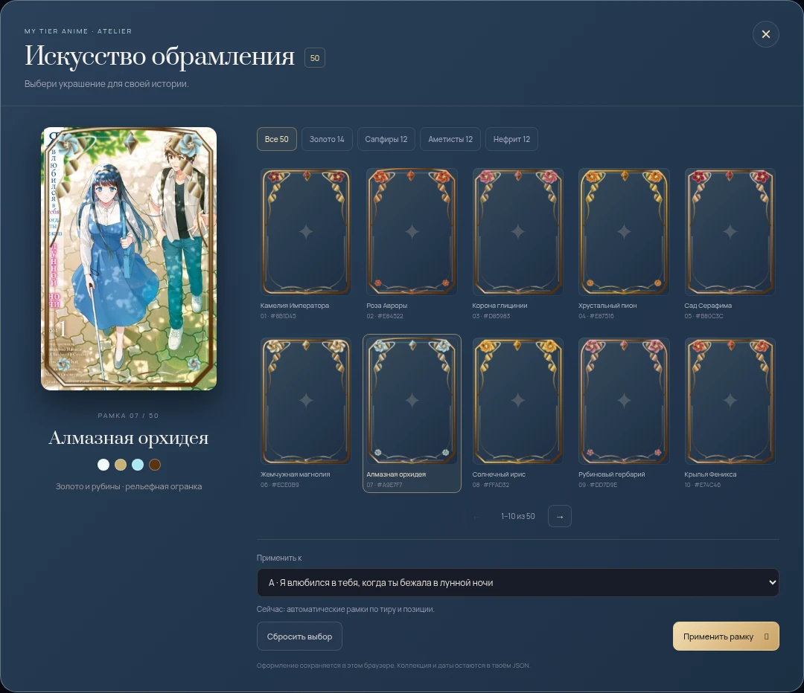

| Семейство | Моделей | Характер |
|:---|---:|:---|
| **Золото и рубины** | 14 | Камелии, розы, пионы, глициния, гранаты и тёплая огранка. |
| **Сапфиры и лёд** | 12 | Гортензии, эустомы, аквамарин, серебро и холодное стекло. |
| **Аметисты и ночь** | 12 | Фиалки, орхидеи, лаванда, лиловые лепестки и обсидиан. |
| **Нефрит и жемчуг** | 12 | Лотосы, гинкго, бамбук, магнолии и перламутр. |

Открой **«✦ Рамки 50»**, выбери модель и посмотри её на постере.
Применение — отдельной кнопкой: к одному аниме или ко всей коллекции.
Выбор сохраняется в браузере, а «Сбросить выбор» возвращает автоматическое оформление.
Идентификаторы моделей сохранены, поэтому прежние настройки получают новую версию рамок.

Боковые плашки **остаются на своём месте при прокрутке**. Двигаются буквы
и световые композиции внутри них. Системное уменьшение движения учитывается.

## Открытка любимой истории

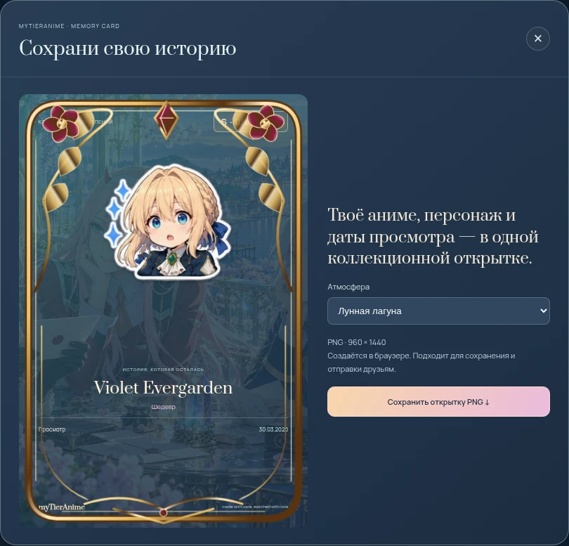

**Аниме → «✦ Открытка PNG» → атмосфера → «Сохранить открытку».**

- Файл **960 × 1440**, создаётся в браузере.
- Выбранная рамка, персонаж, название и тир.
- До трёх последних дат на открытке; полная история остаётся в коллекции.
- В оформлении используется встроенная иллюстрация, поэтому открытке не нужен внешний сервер обложек.

## Коллекция на телефоне

<table><tr>
<td width="50%" align="center">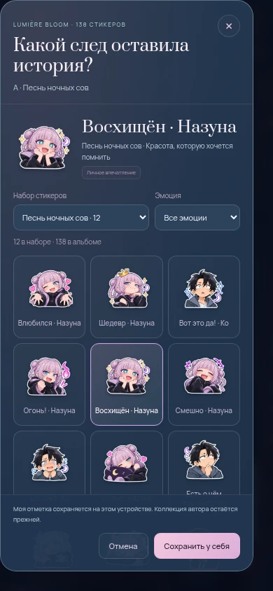 Крупные стикеры, выбор набора и доступная кнопка сохранения.</td>
<td width="50%" align="center">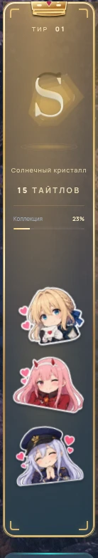 Персонажи в свободной части плашки S.</td>
</tr></table>

Карточка открывается **нажатием**. Название и даты сезонов остаются внутри неё;
длинная история прокручивается отдельно. Размер постеров, движение, материалы
и режим плавности настраиваются в панели эффектов.

## Даты, календарь и сохранение

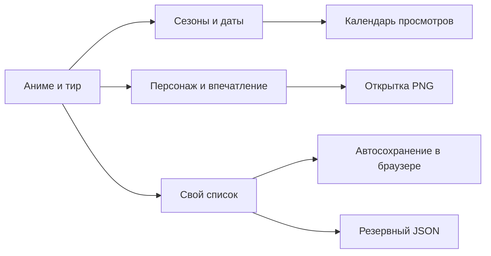

**Свой редактируемый список:** изменения сохраняются в браузере и IndexedDB;
подключённый файл обновляется при выданном разрешении. Экспорт JSON сохраняет
коллекцию, даты, `reaction`, `fav`, декоративный `sticker` и время `duration` / `watchTotal`. Рамки, режим плавности
и тема открытки — настройки этого браузера.

**Опубликованная коллекция:** просмотр не переписывает список автора.
Посетитель может сохранить личную реакцию у себя на устройстве и вернуть
исходную кнопкой «Как у автора». Такие отметки не включаются в JSON автора
и не синхронизируются между устройствами.

Если браузер не разрешил сохранение, приложение сообщает об этом. Обложки
из внешних каталогов требуют доступа к соответствующим хостингам;
встроенные иллюстрации и стикеры работают без них.

### Снимок коллекции

| Файл · актуализирован 21.10.2026 | S | A | B | C | Аниме | Записи просмотра |
|:---|---:|---:|---:|---:|---:|---:|
| [data.json](data.json) | 15 | 22 | 16 | 14 | **67** | **77** |
| [anime-tierlist-2026-10-11.json](anime-tierlist-2026-10-11.json) | 15 | 22 | 16 | 14 | **67** | **77** |

В V4.0 был добавлен декоративный выбор персонажей. Названия, обложки,
расположение по тирам, даты, сезоны, избранное и прежние впечатления сохранены.
Приблизительные даты по-прежнему отмечены в данных; точные не заменены догадками.

### Предыдущие обновления

| Версия | Что появилось |
|:---|:---|
| **V3.1** | Альбом реакций, карта впечатлений, личные отметки посетителя и случайное воспоминание. |
| **V3.0.2** | Возвращены анимации эмблем S/A/B/C; «Форма голоса» перенесена в B. |
| **V3.0.1** | Исправлена обложка «Я влюбился в тебя, когда ты бежала в лунной ночи»: выбранный вариант с синим платьем и белой тростью. |
| **V3.0** | Ателье из 50 моделей, новые записи коллекции и синхронизация снимков. |
| **Ранее** | Календарь по месяцам, история сезонов, альбом героев S-тира и просмотр карточек нажатием. |

### Идеи и источники

При создании учитывались [рекомендации web.dev по быстрым анимациям](https://web.dev/articles/animations-guide),
[видимость содержимого](https://developer.mozilla.org/en-US/docs/Web/CSS/content-visibility),
[Intersection Observer](https://developer.mozilla.org/en-US/docs/Web/API/Intersection_Observer_API),
[CSS 3D](https://developer.mozilla.org/en-US/docs/Web/CSS/transform-style)
и [доступные диалоги WAI-ARIA](https://www.w3.org/WAI/ARIA/apg/patterns/dialog-modal/).

myTierAnime · <b>V4.2.0 — Memory Dimension</b> · 23.10.2026

