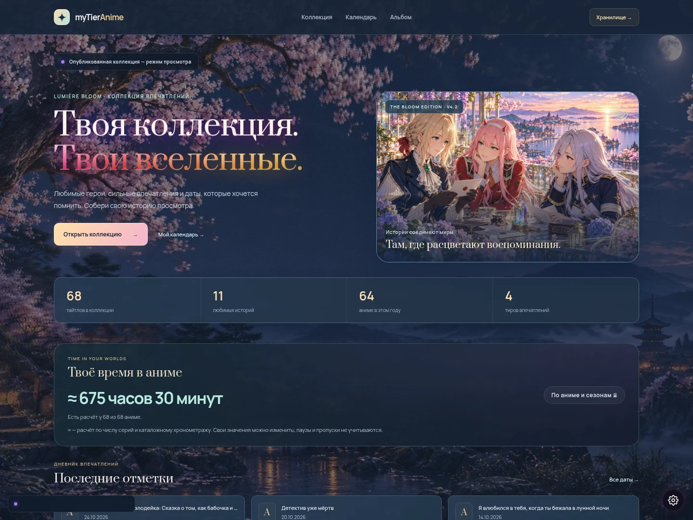
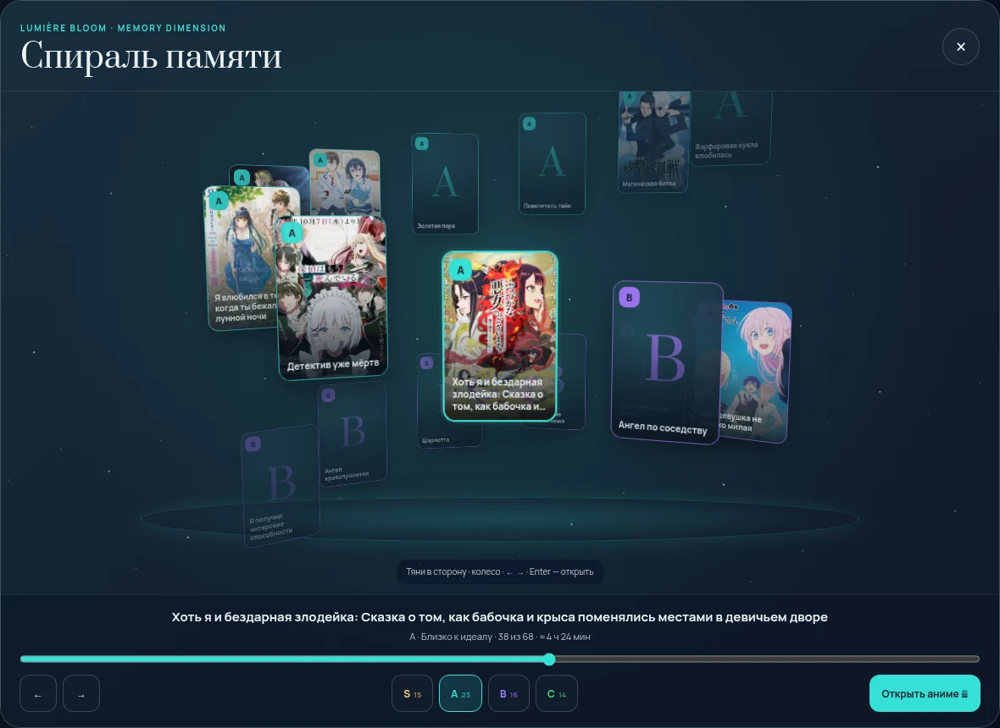
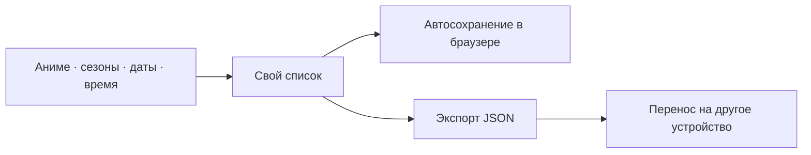

**Любимые истории заслуживают своего места.**

Личная коллекция аниме: тиры, даты каждого сезона, календарь, впечатления персонажами и время, проведённое в любимых мирах.

   

[**Открыть коллекцию ↗**](https://geraltschwarzenegger-svg.github.io/myTierAnime/?collection=2026-10-24) &nbsp; · &nbsp; [Скачать HTML](https://raw.githubusercontent.com/geraltschwarzenegger-svg/myTierAnime/main/NEWAnime%20tier%20list11-08-2026.html) &nbsp; · &nbsp; [Резервный JSON](anime-tierlist-2026-10-11.json)

[Возможности](#что-умеет-коллекция) · [Текущий список](#коллекция) · [Сохранения](#как-хранится-список) · [Обновления](#история-обновлений)

---

## Коллекция

Здесь собирается личный канон: **S — шедевры**, **A — близко к идеалу**, **B — крепкая основа**, **C — достойные**. Порядок отражает впечатления владельца.

| S | A | B | C | Всего аниме | Отметок просмотра |
|:---:|:---:|:---:|:---:|:---:|:---:|
| **15** | **23** | **16** | **14** | **68** | **78** |

**Расчётное время: ≈ 675 часов 30 минут.** Это сумма указанного объёма просмотра, а не таймер плеера. Собственные значения можно изменить в карточках.

<b>Последнее пополнение · 24 октября 2026</b>

### Хоть я и бездарная злодейка: Сказка о том, как бабочка и крыса поменялись местами в девичьем дворе

| Тир | Дата просмотра | Просмотрено | Расчёт времени |
|:---:|:---:|:---|:---|
| **A** | **24.10.2026** | **1 сезон · 11 серий** | **11 × 24 мин = 4 ч 24 мин** |

Обложка и длительность серии взяты из [Kitsu](https://kitsu.app/anime/49689). Дата, количество просмотренных серий и тир указаны владельцем. [Копия обложки хранится в проекте](assets/covers/inept-villainess.png).

<b>Где лежит актуальный список и что входит в JSON</b>

| Файл | Назначение |
|:---|:---|
| [data.json](data.json) | Опубликованная коллекция, которую загружает сайт. |
| [anime-tierlist-2026-10-11.json](anime-tierlist-2026-10-11.json) | Синхронная резервная копия коллекции. Дата в имени — название файла, а не дата последнего обновления. |

Оба файла актуализированы **24.10.2026** и содержат одинаковый список: названия, тиры, обложки, сезоны, даты, избранное, реакции, декоративные стикеры и длительности просмотра. Одна запись аниме может содержать несколько сезонов или фильмов, поэтому отметок просмотра больше, чем тайтлов.

Тема, выбор рамок и настройки движения хранятся отдельно в браузере. Перед переносом своей коллекции на другое устройство сделай свежий экспорт JSON.

## Что умеет коллекция

| Возможность | Для чего она нужна |
|:---|:---|
| **Карточка по нажатию** | Открывает обложку, тир, реакцию и все даты. Длинная история сезонов прокручивается внутри карточки. Работает и с постерами, и с компактными чипами. |
| **Календарь по месяцам** | Показывает, когда ты смотрел аниме. Выбери день, чтобы увидеть связанные истории и сезоны. |
| **Время просмотра** | Считает серии × минуты или принимает собственные часы и минуты. Общий итог аниме заменяет сумму его отдельных записей, чтобы не считать их дважды. |
| **Спираль памяти · 3D** | Собирает коллекцию в объёмную сцену. Можно перелистывать, перейти к нужному тиру и открыть обычную карточку выбранного аниме. |
| **Поиск и впечатления** | Помогают найти название, избранное или истории с определённой эмоцией. «Случайное воспоминание» предлагает вернуться к одной из них. |
| **Альбом и открытки** | Сохраняют настроение коллекции: герои S-тира, пары и открытка выбранного аниме в PNG. |

<b>Посмотреть главную страницу</b>

Вайолет, Зеро Ту и Лена остаются частью оформления. Иллюстрации — неофициальный фан-арт, подготовленный для проекта.

<b>Как работает «Спираль памяти»</b>

Открой **«Спираль памяти»** рядом с ателье рамок. Перелистывай перетаскиванием, колесом, касанием или стрелками. Кнопки тиров и ползунок помогают быстро найти нужное аниме; **«Открыть аниме»** возвращает к его привычной карточке.

Сцена читает текущую коллекцию и обновляется после добавлений или удаления. На компьютере одновременно создаётся до **17 ближайших постеров**, на телефоне и в лёгком режиме — до **9**. Постоянного вращения в ожидании ввода нет; после закрытия сцена освобождает ресурсы.

Системное уменьшение движения и настройки сайта учитываются. Навигация по спирали не меняет аниме, даты, реакции или время просмотра.

<b>Откуда берутся часы и минуты</b>

В карточке можно выбрать **«Серии × минуты»** или задать собственный итог в часах и минутах. Например, 11 серий по 24 минуты дают **264 минуты**.

- Знак **≈** обозначает оценку по каталожному хронометражу.
- Неуказанное время остаётся неизвестным, а не превращается в ноль.
- Общая длительность аниме учитывается вместо суммы сезонов, если она задана.
- Фильм и его телевизионный пересказ не должны попадать в итог дважды.
- Паузы, пропущенные заставки и фактическое время за экраном автоматически не измеряются.

[Источники и расчёт каждого аниме](docs/watchtime-sources.md) · [Каталог длительностей](assets/catalog/watchtime.json)

## Впечатления и оформление

**138 стикеров персонажей из 19 аниме** и **50 рамок** позволяют оформить коллекцию по-своему. Среди наборов — герои S-тира, «Песнь ночных сов», «Фарфоровая кукла влюбилась», «Ангел по соседству» и «Магическая битва».

<b>Стикер, реакция и избранное — что меняется при выборе</b>

Открой аниме, выбери набор и эмоцию, затем сохрани. Доступны любовь, восхищение, удивление, огонь, смех, слёзы, уют, размышление и другие впечатления.

**Декоративный стикер** украшает постер. **Реакция** выражает отношение к просмотру. **Избранное** — отдельная отметка. Они не подменяют друг друга.

Карта впечатлений объединяет одинаковые эмоции разных персонажей. Например, «До слёз» найдёт все соответствующие отметки независимо от набора. На опубликованной странице личная реакция посетителя сохраняется у него в браузере; список автора при этом не переписывается.

[Песнь ночных сов](assets/reactions/call-of-the-night.webp) · [Фарфоровая кукла](assets/reactions/dress-up-darling.webp) · [Ангел по соседству](assets/reactions/angel-next-door.webp) · [Магическая битва](assets/reactions/jujutsu-kaisen.webp)

<b>Рамки, материалы и открытка PNG</b>

| Семейство рамок | Моделей | Материалы и мотивы |
|:---|---:|:---|
| Золото и рубины | 14 | Розы, пионы, камелии, гранаты и тёплая огранка. |
| Сапфиры и лёд | 12 | Гортензии, серебро, аквамарин и холодное стекло. |
| Аметисты и ночь | 12 | Орхидеи, фиалки, лаванда и обсидиан. |
| Нефрит и жемчуг | 12 | Лотосы, гинкго, бамбук и перламутр. |

В ателье **«Рамки 50»** можно сначала посмотреть модель на постере, а затем применить её к одному аниме или ко всей коллекции. Сброс возвращает автоматическое оформление.

**Открытка:** аниме → **«Открытка PNG»** → атмосфера → сохранить. Получается изображение **960 × 1440** с персонажем, названием, тиром, выбранной рамкой и последними датами. Полная история остаётся в коллекции.

## Как хранится список

В своём редактируемом списке изменения сохраняются в **localStorage** и **IndexedDB**. Подключённый JSON-файл обновляется при наличии разрешения браузера. На опубликованной странице посетитель просматривает коллекцию автора.

<b>Перенос, восстановление и первый запуск HTML</b>

1. В старом браузере открой **«Хранилище» → «Экспорт JSON»**.
2. На другом устройстве открой сайт или HTML-файл и выбери **«Импорт JSON»**.
3. Проверь предложенный список перед заменой или объединением.

В новом браузере автономный HTML может открыться без коллекции: он не должен самостоятельно подменять твой список. Импортируй свежую резервную копию. Если уже есть более новые личные записи, используй свой экспорт, а не опубликованный снимок из репозитория.

Настройки оформления и личные реакции посетителя не переносятся вместе с JSON автора. Внешним обложкам нужен доступ к их хостингам; встроенные иллюстрации и стикеры от них не зависят. При ошибке сохранения приложение показывает сообщение — экспорт JSON остаётся отдельным способом сделать копию.

## История обновлений

<b>24.10.2026 · Коллекция и новая документация</b>

- Добавлена «Хоть я и бездарная злодейка…» в **A**: **24.10.2026**, **1 сезон · 11 серий**.
- Коллекция выросла с **67 до 68 аниме**, число отметок — с **77 до 78**.
- К общему времени добавлено **4 ч 24 мин**; новый итог — **≈ 675 ч 30 мин**.
- Обложка сохранена в проекте; основной JSON и резервная копия синхронизированы.
- README переписан: новые раскрывающиеся блоки, актуальные цифры, скриншоты и баннер с лунным садом.
- **Версия интерфейса остаётся V4.2.0.** Это обновление коллекции и документации.

<b>V4.2.0 · Спираль памяти · 23.10.2026</b>

Интерактивная 3D-коллекция, переходы по тирам, касания, возвращение к обычной карточке и локальная подсветка постеров. Ограниченная отрисовка, поддержка лёгкого режима и уменьшения движения; совместимость с PNG-экспортом.

<b>Предыдущие этапы · время, Lumière Bloom, реакции и календарь</b>

| Этап | Что появилось |
|:---|:---|
| **V4.1 · 21.10.2026** | Учёт часов и минут, расчёт по сезонам и фильмам, собственный ввод длительности, источники. |
| **20.10.2026** | «Детектив уже мёртв» в A: первый сезон, 12 серий. |
| **V4.0 · 18.10.2026** | Lumière Bloom, иллюстрации с Вайолет, Зеро Ту и Леной, 138 стикеров, переработанные рамки, открытки и режим плавности. |
| **V3.1** | Карта впечатлений, личные реакции посетителей и случайное воспоминание. |
| **V3.0 и ранее** | Ателье 50 рамок, календарь по месяцам, история сезонов, альбом и карточки по нажатию. |

Оптимизация V4.0 сократила число SVG в рамке с восьми до одного: **на 87,5% меньше SVG-элементов этого уровня**. Это измерение структуры, а не обещание такого же прироста FPS. [Подробности](docs/performance-v4.md).

<b>Следующий этап · Astral Studio пока не опубликована</b>

Локально подготовлены девять атмосфер, четыре темы, новые скульптуры тиров, восемь дополнительных рамок, сценарии оформления и автоматизация света. Эти возможности ещё **не входят в опубликованную V4.2.0**. Название и номер будущего большого релиза не закреплены.

<b>Иллюстрации и источники</b>

Обновлённый баннер сохраняет Вайолет, Зеро Ту и Лену; фон дополнен лунным озером, сакурой, фонарями и глубиной оранжереи. [Иллюстрация баннера](docs/images/readme-night-garden.webp) · [Прежняя иллюстрация](docs/images/bloom-keyvisual.webp).

Персонажи принадлежат их правообладателям; оформление — неофициальный фан-арт. Обложки и сведения о длительности берутся из каталогов, а даты и оценки — из личных записей владельца. [Источники хронометража](docs/watchtime-sources.md).

При работе над интерфейсом использованы рекомендации [web.dev по анимациям](https://web.dev/articles/animations-guide), [MDN по CSS 3D](https://developer.mozilla.org/en-US/docs/Web/CSS/transform-style) и [WAI-ARIA по диалогам](https://www.w3.org/WAI/ARIA/apg/patterns/dialog-modal/).

---

myTierAnime · Интерфейс <b>V4.2.0</b> · Коллекция и README обновлены <b>24.10.2026</b>

