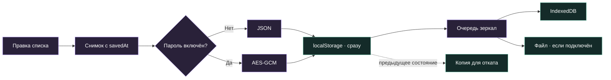

<div align="center">


**Не просто «что лучше». Что осталось в памяти — и когда ты это смотрел.**

Личная коллекция аниме с живыми эмблемами, календарём просмотров и вечерним садом сакуры.

[](src/app.html)
[](#-начать-за-минуту)
[](#-четыре-характера)
[](#-данные-остаются-у-тебя)

[**Скачать офлайн-файл**](https://raw.githubusercontent.com/geraltschwarzenegger-svg/myTierAnime/main/NEWAnime%20tier%20list11-08-2026.html)
&nbsp;·&nbsp; [Версия для сайта](https://raw.githubusercontent.com/geraltschwarzenegger-svg/myTierAnime/main/index.html)
&nbsp;·&nbsp; [Сервер и публикация](site/README.md)
&nbsp;·&nbsp; [Резервный JSON](anime-tierlist-2026-09-21.json)

</div>

---

## ✦ Твоя коллекция, твой ритм


*Интерфейс приложения: тиры, даты, эмблемы и фон с большой сакурой. Доступность обложек зависит от их источников.*

| Собрать | Вспомнить | Настроить |
|:---|:---|:---|
| Постеры или компактные чипы | Календарь по месяцам | Четыре живые эмблемы |
| Перетаскивание между тирами | Даты каждого сезона и пересмотра | Большая сакура и ещё пять сцен |
| Поиск и любимые | Список за выбранный день | Размер постеров от 94 до 190 px |
| Свои обложки и реакции | Выделение просмотров в коллекции | Превью 320 px и эффект послесвечения |
| До восьми собственных тиров | Личная отметка «Моя дата» | Управление движением и свечением |

## ✦ Четыре характера

<div align="center">


</div>

| Тир | Стиль «Стихии» | Движение | Для каких впечатлений |
|:---:|---|---|---|
| **S** | **Сияние** | раскрывающиеся световые ленты, золотая объёмная буква | шедевры, которые хочется сохранить |
| **A** | **Призма** | складывающиеся грани и стеклянные отражения | истории, близкие к идеалу |
| **B** | **Тушь** | проявляющиеся каллиграфические мазки и лёгкий дрейф | крепкие истории со своим голосом |
| **C** | **Сакура** | цветущая веточка, покачивание и падающие лепестки | достойные знакомства |

Названия, порядок и цвета тиров задаёт владелец. Стиль зависит от позиции тира;
для пятого–восьмого композиции повторяются в их собственных цветах.
В панели **Эффекты → Эмблемы тиров** доступны также **Орбиты 3D** и **Классика**.

**Послесвечение** заменяет прежние острые крылья: у просмотренного аниме
на мгновение проявляются тонкая рамка, блик и несколько световых частиц.
Работает при наведении, фокусе с клавиатуры и касании; уходит при прокрутке
или выходе с карточки. В режиме редактирования оно выключено.

> [!TIP]
> Ничего не движется? Открой **Эффекты → Включить движение и проверить**.
> Панель показывает состояние анимации. **Авто** учитывает системное уменьшение
> движения, **Анимации** включают его явно, **Без движения** оставляет спокойный интерфейс.
> Послесвечение карточек и движение эмблем отключаются отдельно.

Фон с сакурой встроен в HTML. При первом запуске обновления старый выбор
встроенной сцены заменяется новой сакурой; собственная фотография сохраняется.
Последующие переключения фона и стиля запоминаются. Эмблемы за пределами экрана
и эффекты в фоновой вкладке приостанавливаются.

## ✦ Даты, которые складываются в историю


- **Месяц целиком:** неделя с понедельника, отметка сегодняшнего дня, количество просмотров и цвета тиров.
- **Один день:** нажми дату, чтобы увидеть аниме и сезоны; **В коллекции** выделит их постеры.
- **Несколько просмотров:** у сезонов, фильмов и повторных просмотров могут быть отдельные даты.
- **Список / Без даты:** хронологическая история, поиск и тайтлы, которые ещё нужно отметить.
- **Моя дата:** компактная личная отметка над коллекцией — вручную или автоматически на текущий день.

Даты просмотра хранятся вместе с тайтлами и входят в экспорт JSON.
«Моя дата», фон и настройки эффектов относятся к этому браузеру и не меняют даты аниме.

## ✦ Начать за минуту

1. **Скачай [офлайн-файл](https://raw.githubusercontent.com/geraltschwarzenegger-svg/myTierAnime/main/NEWAnime%20tier%20list11-08-2026.html)** и сохрани с расширением `.html`.
2. **Открой в браузере.** Шрифты, фон и библиотека PNG-экспорта уже внутри; интернет нужен для внешних обложек и сетевых функций.
3. **Добавь своё аниме** или импортируй JSON через **Хранилище → Импорт**. Выбери тир, обложку и даты.
4. **Сохрани резервный JSON.** При желании подключи файл-хранилище для автоматической записи на диск.

| Режим | Как открыть | Как редактировать и публиковать |
|---|---|---|
| **Офлайн** | скачанный HTML | свой список в браузере; экспорт JSON, опциональная запись в файл |
| **GitHub Pages** | размещённый `index.html` и `data.json` | гости смотрят; владелец публикует с настроенным доступом к репозиторию |
| **Cloudflare Workers + D1** | развёрнутый сервер | вход по коду на почту, свой адрес и публикация своего списка |

Подробности развёртывания — в [инструкции сервера](site/README.md).
Загрузка файлов в GitHub сама по себе не включает GitHub Pages или Cloudflare.

## ✦ Данные остаются у тебя



| Слой | Что происходит | Что нужно помнить |
|---|---|---|
| **localStorage** | незашифрованная правка записывается сразу; сохраняется предыдущая копия | принадлежит конкретному браузеру и адресу страницы |
| **IndexedDB** | зеркало после короткой задержки; записи идут по порядку | очистка данных сайта может удалить оба браузерных хранилища |
| **Файл-хранилище** | та же версия автоматически записывается в подключённый файл | требуется разрешение браузера; File System Access API поддерживается не везде |
| **JSON-экспорт** | отдельный переносимый снимок коллекции | полезен для другого устройства и резервной копии |
| **Публикация** | обновляет список на сайте по кнопке | локальное автосохранение не означает автоматическую публикацию |

При запуске своего списка приложение сравнивает метки `savedAt` доступных копий.
В чужом опубликованном списке работает режим чтения: он не записывается поверх своего.

Поздний результат шифрования не может затереть свежую правку. Записи зеркал
выполняются последовательно, а при недоступном хранилище индикатор показывает ошибку.
Автосохранение в браузере не заменяет отдельный резервный файл: закрытие вкладки
во время незавершённого шифрования или очистка данных браузера могут привести к потере правки.

<details>
<summary><b>Пароль и защита списка</b></summary>

Ключ выводится через **PBKDF2-SHA256, 250 000 итераций**; список шифруется
**AES-GCM-256** до записи в хранилища. Если включена защита, подключённый
файл также получает зашифрованный конверт.

Пароль не сохраняется и не восстанавливается. Сохраняй резервную копию и пароль
отдельно. Доступна автоматическая блокировка после 15 минут бездействия.

</details>

<details>
<summary><b>Почему в репозитории два разных JSON?</b></summary>

Оба файла корректны, но представляют разные версии коллекции. Проверено **10 октября 2026**.

| Снимок | S | A | B | C | Всего | Записи просмотра |
|---|---:|---:|---:|---:|---:|---:|
| [`data.json`](data.json) — опубликованные данные | 15 | 16 | 15 | 14 | **60** | 37 |
| [`anime-tierlist-2026-09-21.json`](anime-tierlist-2026-09-21.json) — резервный снимок | 15 | 18 | 15 | 15 | **63** | 40 |

В сентябрьском снимке дополнительно есть **«Золотая пора»**, **«Повелитель тайн»**
и **«Токийский гуль»**. Метки `savedAt`: 15 августа и 21 сентября соответственно.
Уникальность ID, схема, `nextUid`, реакции и календарные даты проверены.
Файлы не объединяются автоматически: выбирай нужный снимок при импорте.

</details>

## ✦ Клавиатура

| Клавиши | Действие |
|:---:|---|
| <kbd>N</kbd> | добавить аниме |
| <kbd>E</kbd> | режим редактирования |
| <kbd>G</kbd> / <kbd>C</kbd> | постеры / чипы |
| <kbd>/</kbd> | поиск |
| <kbd>Tab</kbd> | перейти к карточке; <kbd>Enter</kbd> / <kbd>Пробел</kbd> — правка в режиме редактирования |
| <kbd>Esc</kbd> | закрыть окно |
| <kbd>←</kbd> <kbd>→</kbd> <kbd>↑</kbd> <kbd>↓</kbd> | дни в календаре |
| <kbd>Home</kbd> / <kbd>End</kbd> | начало / конец недели |
| <kbd>Page Up</kbd> / <kbd>Page Down</kbd> | предыдущий / следующий месяц; с <kbd>Shift</kbd> — год |

## ✦ Для разработки

Канонический интерфейс — [`src/app.html`](src/app.html). Из него собираются
сайт и автономный файл; изменения в готовых HTML отдельно не нужны.

```text
src/app.html                      интерфейс и логика
index.html                        сборка для GitHub Pages
site/public/index.html            та же сборка для Workers
site/src/index.js                 сервер и API
site/test/worker.test.mjs          серверные тесты
tools/test/persistence.test.mjs   тесты сохранения и двух JSON
tools/mksite.py                   сборка сайта
tools/bundle.py                   обновление офлайн-шаблона
```

**Сборка** — Python 3, без установки пакетов:

```bash
python3 tools/mksite.py src/app.html index.html
cp index.html site/public/index.html
python3 tools/bundle.py pack 'NEWAnime tier list11-08-2026.html' src/app.html
```

**Проверки** — Node.js 24+; зависимости и сеть для этих тестов не нужны:

```bash
node --test tools/test/persistence.test.mjs site/test/worker.test.mjs
```

Тесты сохранения проверяют реальный код приложения: порядок шифрования,
последовательные записи в файл, ошибки хранилищ, повтор записи и режим чтения.
Серверные тесты проверяют вход, права доступа, публикацию, профиль и ограничения API.
PNG-экспорт, жесты и внешний вид дополнительно проверяются в браузере.

<details>
<summary><b>Технические ориентиры</b></summary>

- [MDN: Web Animations API](https://developer.mozilla.org/en-US/docs/Web/API/Element/animate) — короткие эффекты и отмена анимаций.
- [web.dev: производительные анимации](https://web.dev/articles/animations-guide) — движение через `transform` и `opacity`.
- [W3C: доступный календарь](https://www.w3.org/WAI/ARIA/apg/patterns/dialog-modal/examples/datepicker-dialog/) — навигация и фокус.
- [GitHub: Mermaid-диаграммы](https://docs.github.com/en/get-started/writing-on-github/working-with-advanced-formatting/creating-diagrams) — схемы прямо в README.

</details>

---

<div align="center">

**Собирай впечатления. Оставляй даты. Возвращайся к любимому.**

</div>
