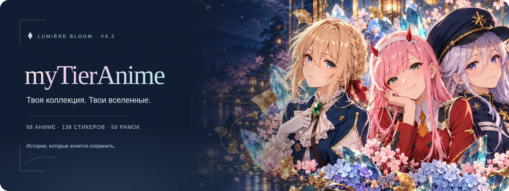
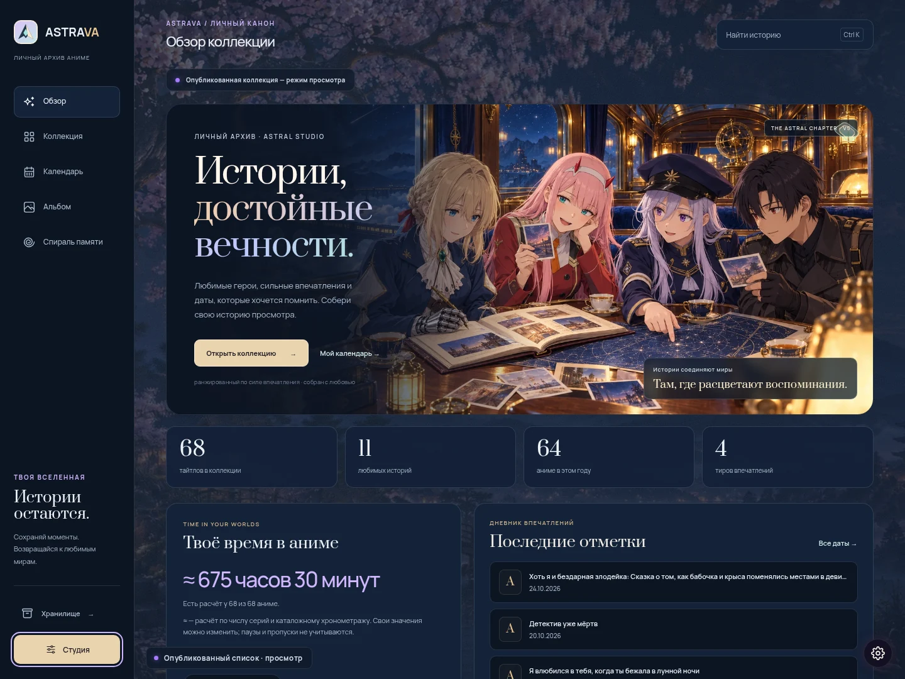
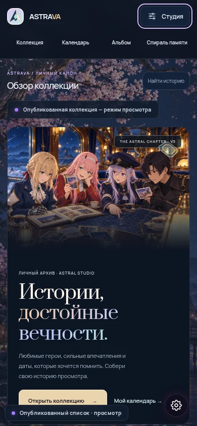
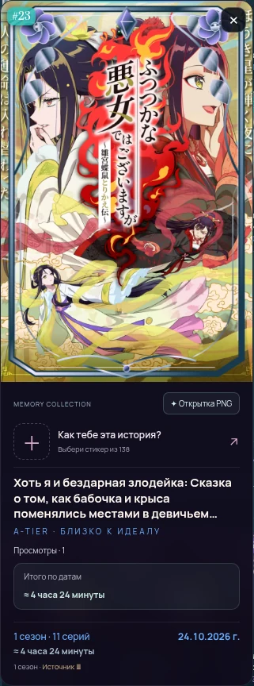
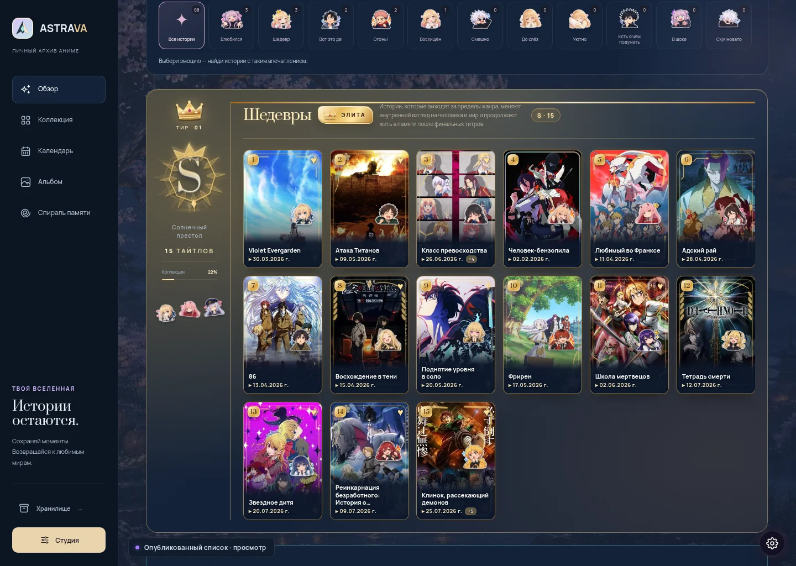
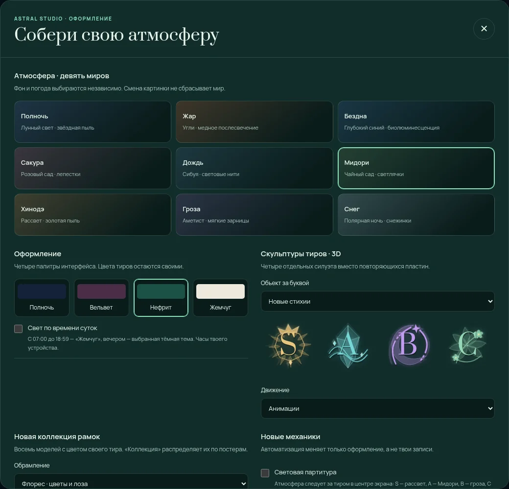
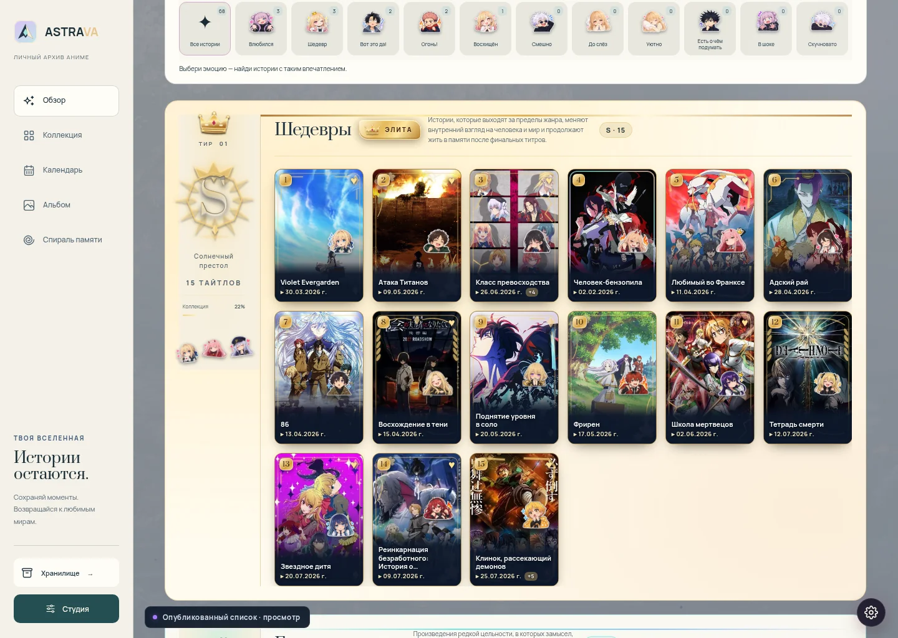
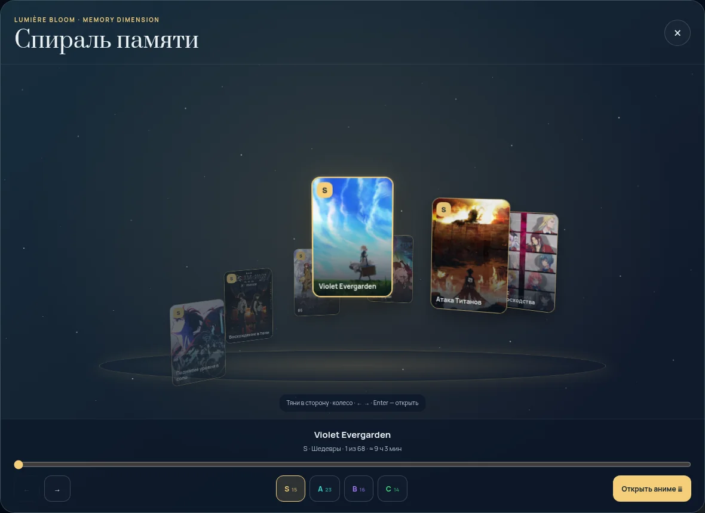

**Истории, достойные вечности.**

Личный архив аниме, в котором у каждого мира есть своё место, цвет и настроение.

    

[**Открыть ASTRAVA ↗**](https://geraltschwarzenegger-svg.github.io/myTierAnime/?v=5.0.0) &nbsp; · &nbsp; [**Скачать офлайн-версию · ZIP**](https://raw.githubusercontent.com/geraltschwarzenegger-svg/myTierAnime/main/downloads/ASTRAVA-v5.0.0.zip) &nbsp; · &nbsp; [**Резервный JSON**](anime-tierlist-2026-10-11.json)

[Коллекция](#коллекция) · [Студия](#студия-оформления) · [Спираль памяти](#спираль-памяти) · [Сохранения](#твоя-коллекция-и-сохранения) · [Обновления](#что-нового-на-сайте-changelog)

---

## The Astral Chapter

**ASTRAVA** — новое имя проекта **myTierAnime**. В V5 коллекция получила Студию оформления: меняй атмосферу, переключай дневную и вечернюю палитры, выбирай украшения и собирай собственные сочетания. Вайолет, Зеро Ту и Лена остаются частью визуального образа.

Главная страница объединяет коллекцию, время просмотра и последние отметки. Нажатие на постер открывает подробную карточку с сезонами, датами и впечатлением. Для другого взгляда на знакомые истории есть интерактивная **3D-спираль памяти**.

### Новое рабочее пространство

На компьютере разделы собраны в постоянной боковой навигации: обзор, коллекция, календарь, альбом и спираль памяти. Студия и хранилище находятся в той же панели. Панорамная иллюстрация задаёт настроение, отдельные плитки показывают статистику, а время просмотра и последние отметки собраны рядом.

Коллекция оформлена разделами галереи: компактная 3D-эмблема, заголовок тира и постеры в одной поверхности. На широком экране подробная карточка открывается справа. На телефоне навигация становится верхней, обзор перестраивается в одну колонку, а эмблемы располагаются над постерами.

Кнопка **«Найти историю»** переводит к поиску коллекции.

<b>Как выглядит мобильная версия</b>

## Коллекция

| S · Шедевры | A · Близко к идеалу | B · Крепкая основа | C · Достойные | Всего | Отметок просмотра |
|:---:|:---:|:---:|:---:|:---:|:---:|
| **15** | **23** | **16** | **14** | **68** | **78** |

**Расчётное время — ≈ 675 часов 30 минут.** Каждый сезон или фильм может иметь отдельную дату и длительность. Это сумма записанного объёма просмотра; собственные значения можно изменить.

<b>Последнее пополнение · 24 октября 2026</b>

**Хоть я и бездарная злодейка: Сказка о том, как бабочка и крыса поменялись местами в девичьем дворе**

| Тир | Дата | Просмотрено | Время |
|:---:|:---:|:---|:---|
| A | 24.10.2026 | 1 сезон · 11 серий | 11 × 24 мин = **4 ч 24 мин** |

Тир, дата и число просмотренных серий указаны владельцем. Обложка и длительность серии — [Kitsu](https://kitsu.app/anime/49689). [Источники расчёта времени](docs/watchtime-sources.md).

<b>Постеры, компактные чипы и поиск</b>

- **Постеры** показывают обложку, место в тире, название, дату и декоративный стикер.
- **Чипы** помогают быстро просмотреть большой список.
- **Размер карточек** регулирует плотность коллекции.
- **Поиск, избранное и фильтр впечатлений** помогают найти нужную историю.
- **Подробная карточка открывается нажатием** — на компьютере и телефоне. Большой список сезонов прокручивается внутри; кнопка закрытия остаётся доступна.

Тир S получил золотое оформление, корону и знак «Элита». Обрамление украшает края постера, сохраняя читаемость названия и дат.

## Студия оформления

Открой **«Студия»** в верхнем меню. Настройки применяются сразу и сохраняются в текущем браузере. В одной панели собраны палитры, атмосферы, 3D-скульптуры, новые рамки и автоматизация.

### Девять миров

| Мир | Характер сцены | Погода и свет |
|:---|:---|:---|
| **Полночь** | Синий вечер, тишина и глубина | Медленная звёздная пыль |
| **Жар** | Медные и янтарные оттенки | Поднимающиеся искры |
| **Бездна** | Холодный синий | Светящиеся частицы |
| **Сакура** | Розовый вечерний сад | Лепестки при включённом эффекте лепестков |
| **Дождь** | Сибуя, прохладный городской свет | Наклонённые дождевые нити |
| **Мидори** | Нефритовый чайный сад | Светлячки |
| **Хинодэ** | Золотой рассвет | Тёплая световая пыль |
| **Гроза** | Аметистовая ночь | Дождь и редкая мягкая подсветка |
| **Снег** | Полярная палитра | Снегопад |

<b>Почему атмосферы теперь сохраняют выбор</b>

Раньше фон и панель эффектов независимо управляли одними классами. Изменение фотографии или ползунка могло стереть атмосферу, а следующая кнопка эффектов — вернуть другой сохранённый вариант.

В V5 выбор проходит через одно состояние оформления. Новая Студия и прежняя панель эффектов используют его совместно. Фотография, размытие, насыщенность и параллакс сохраняют выбранный мир. Явный выбор старых сцен «Угли», «Бездна» или «Сакура» включает соответствующую атмосферу.

Погода работает на одном отдельном канвасе. Старый цикл фоновых частиц при активной Студии остановлен. Выбор мира сохраняется после перезагрузки и синхронизируется между вкладками одного браузера.

### Четыре темы

| Тема | Палитра | Для какого настроения |
|:---|:---|:---|
| **Полночь** | Тёмный синий, светлые чернила | Вечерняя коллекция |
| **Вельвет** | Баклажан и шампань | Тёплая галерея |
| **Нефрит** | Зелёная глубина и мята | Тихий сад |
| **Жемчуг** | Светлый туман и тёмные чернила | Дневной просмотр |

«Жемчуг» меняет также поля ввода, диалоги и основные панели. Цвета S/A/B/C и сами обложки сохраняют свою идентичность.

<b>Наборы, отмена изменений и перенос оформления</b>

Есть четыре готовых сочетания: **Чайный сад**, **Имперский зал**, **Тихий дождь**, **Утренний архив**. Кнопка **«Сохранить мой набор»** запоминает собственный вариант.

**Отменить / Повторить** возвращают последние **12 изменений оформления в текущей сессии**. Несколько движений ползунка до завершения одного изменения считаются одним шагом. После перезагрузки история отмены начинается заново; выбранное оформление остаётся сохранённым.

**Экспорт оформления** создаёт отдельный JSON с темой, атмосферой, сигилом, рамками и переключателями Студии. Импорт принимает файл оформления, проверяет его формат и размер. Аниме и даты в него не входят. Для переноса самой коллекции используй экспорт в «Хранилище».

**«Вернуть начальное оформление»** сбрасывает настройки Студии. Это действие можно отменить кнопкой истории в той же сессии.

<b>Автоматизация: свет, тиры и режим галереи</b>

| Настройка | Поведение |
|:---|:---|
| **Свет по времени суток** | С 07:00 до 18:59 включает «Жемчуг», вечером возвращает выбранную тёмную тему. Использует часы устройства. |
| **Световая партитура** | При прокрутке атмосфера следует за активным тиром: S — Хинодэ, A — Мидори, B — Гроза, C — Сакура. Ручной выбор мира выключает партитуру. |
| **Режим галереи** | Скрывает вступление и сводки, оставляя коллекцию в центре внимания. |
| **Частицы и погода** | Включает или останавливает погодный слой. Переключатель связан с прежней панелью эффектов. |

Автоматизация меняет оформление. Тиры, даты, реакции и длительности просмотра от неё не меняются.

## Скульптуры тиров · 3D

У каждого ранга — отдельный силуэт, два плана глубины и собственное движение. Панель тира остаётся на своём месте при прокрутке; анимируются буква и декоративный объект.

| Тир | Скульптура | Образ |
|:---:|:---|:---|
| **S** | **Солнечный престол** | Золотая корона, лучи и огранённый знак |
| **A** | **Кристаллический прилив** | Призма, водные линии и бирюзовый свет |
| **B** | **Чернильное затмение** | Фиолетовая луна и каллиграфические дуги |
| **C** | **Живая крона** | Листья, цветы и зелёная глубина |

В Студии можно заменить скульптуры на **гранёный кристалл**, **рунное гало**, **знак ранга** или отключить сигил. Пример всех четырёх тиров виден прямо в панели.

<b>Если хочется больше движения или тишины</b>

Проверь общую настройку движения, переключатель **«Анимация букв»** и режим качества. Устройство может сообщать браузеру предпочтение уменьшить движение; режим **«Как настроено на устройстве»** учитывает его.

**«Без движения»** останавливает новые скульптуры и погоду. **«Лёгкий»** отключает дополнительные сигилы и погодный канвас. Когда вкладка скрыта, движение приостанавливается. Для PNG-экспорта декоративная сцена переходит в неподвижное состояние.

## Рамки и собственный стиль

Прежнее ателье с **50 моделями** остаётся доступно. V5 добавляет **ещё восемь** моделей обрамления в Студии — всего **58 вариантов**, распределённых между двумя инструментами.

| Новая рамка | Детали |
|:---|:---|
| **Палатиум** | Металл, лавровые листья и центральный камень |
| **Сокровищница** | Огранённые самоцветы по углам |
| **Флорес** | Цветы, листва и тонкая лоза |
| **Кинцуги** | Золотые швы и трещины |
| **Аврора** | Голографический кант и блик при наведении |
| **Суми-э** | Чернильный край и красная печать |
| **Контур** | Световые схемы и точные угловые линии |
| **Астеризм** | Соединённые звёзды и мелкие кристаллы |

<b>Как сочетать новые рамки с ателье</b>

В Студии есть три режима: **сочетать с прежними**, **показывать только новые**, **оставить только прежние**. Слайдер интенсивности регулирует силу нового орнамента от 0 до 100%.

Вариант **«Коллекция · разные рамки»** распределяет новые модели по идентификаторам аниме. Рисунок остаётся стабильным при поиске, перерисовке и перезагрузке. Можно выбрать одну новую модель сразу для всей коллекции.

Прежние 50 рамок выбираются в ателье, в том числе для конкретного аниме. Их коллекция делится на четыре семейства: S — 14, A — 12, B — 12, C — 12. Декоративные слои пропускают нажатия к постеру.

## Впечатления в персонажах

**138 стикеров из 19 наборов** помогают выразить впечатление от аниме: герои S-тира, «Песнь ночных сов», «Фарфоровая кукла влюбилась» и другие истории. Котики из прежнего набора убраны.

<b>Реакция, украшение и избранное — как пользоваться</b>

- **Реакция** — выбранное впечатление. Открой карточку и нажми на панель реакции, выбери набор и стикер, затем сохрани.
- **Декоративный стикер** украшает постер; у всех 68 опубликованных аниме есть собственный.
- **Избранное** — отдельная отметка для любимых историй.

Полоса впечатлений фильтрует коллекцию по настроению. В публичном режиме собственные реакции сохраняются как личные отметки в браузере. В своей копии коллекции они входят в экспорт JSON.

## Спираль памяти

Вся коллекция собрана в интерактивную 3D-спираль. Перетаскивай сцену, используй колесо, клавиши управления или касание. Быстрые переходы выбирают тир; кнопка **«Открыть карточку»** возвращает к обычному предпросмотру выбранного аниме.

<b>Как спираль справляется с большой коллекцией</b>

В сцене одновременно находятся **до 17 постеров**, а в лёгком режиме — **до 9**. Остальные появляются по мере перемещения. При закрытии диалога узлы сцены освобождаются.

Сцена подхватывает новые карточки после перерисовки. Навигация, вращение и переход к постеру сохраняют содержимое коллекции.

## Календарь и время просмотра

Месячный календарь связывает даты с историями. У сезонов, фильмов и повторных просмотров могут быть отдельные отметки. Дневник коллекции позволяет выбрать собственную дату или использовать текущую дату автоматически.

<b>Из чего складываются часы и минуты</b>

Есть расчёт **по числу серий и минутам на серию**, ручная длительность записи и **собственное общее время аниме**. Собственный итог заменяет сумму частей, чтобы одно время не считалось дважды.

Каталожные минуты округлены. Реальное время с паузами, пропусками и титрами может отличаться. Неизвестная длительность и явно введённые ноль минут различаются. В карточках можно исправить каждое значение и вернуться к каталожному расчёту.

Сведения и исключения перечислены в [источниках времени просмотра](docs/watchtime-sources.md). Для нового аниме от 24 октября используется Kitsu; исходная сверка остальных записей описана отдельно. Объём просмотра, включая индивидуальные значения владельца, хранится в JSON.

## Твоя коллекция и сохранения

**Опубликованный список** открывается в режиме просмотра. Чтобы вести собственную коллекцию, создай свою копию через интерфейс. Перед переносом между устройствами или крупным редактированием скачай свежий JSON из **«Хранилища»**.

<b>Где сохраняются данные и что переносить</b>

| Данные | Как перенести |
|:---|:---|
| Аниме, тиры, даты, сезоны, время, реакции и избранное своей копии | Экспорт и импорт JSON в «Хранилище» |
| Тема, атмосфера, новые рамки и переключатели Студии | «Экспорт оформления» / «Импорт» внутри Студии |
| Личные реакции на опубликованный список | Хранятся локально в текущем браузере |
| История отмены оформления | Только текущая сессия; до 12 шагов |

Личная коллекция использует локальное хранилище и зеркало IndexedDB. После сохранения доступны перезагрузка и дальнейшее редактирование. Смена браузера, адреса сайта или очистка его данных требуют восстановления из экспорта. GitHub Pages сам по себе не синхронизирует личную коллекцию между устройствами.

Если браузер запрещает сохранение оформления, Студия сообщает об этом. Выбранный вид продолжает действовать на открытой странице.

<b>Два JSON-файла в репозитории</b>

| Файл | Назначение |
|:---|:---|
| [data.json](data.json) | Коллекция, опубликованная владельцем |
| [anime-tierlist-2026-10-11.json](anime-tierlist-2026-10-11.json) | Синхронная резервная копия той же коллекции |

В обоих файлах — одинаковые **68 аниме и 78 отметок просмотра**. Последнее пополнение списка — **24.10.2026**. Дата в имени резервного файла — его название; V5 опубликована **25.10.2026**. Номер интерфейса V5 и версия схемы JSON — разные значения.

Релиз оформления сохраняет исходные ID, порядок тиров, даты, реакции и длительности. Локальные копии постеров подключены на уровне отображения; исходные ссылки в записях сохраняются.

<b>Автономный HTML, постеры и PNG</b>

ZIP-архив содержит автономный HTML, резервный JSON, краткую инструкцию и контрольные суммы. Распакуй архив перед открытием HTML.

Автономный файл содержит приложение, шрифты, библиотеку экспорта, встроенные иллюстрации и **все 68 опубликованных обложек**. В новом браузере импортируй свежий JSON коллекции через «Хранилище». Личный список намеренно не подменяется встроенным опубликованным списком.

Добавленные тобой внешние обложки по-прежнему требуют доступного источника, если они не встроены в саму запись. На сайте опубликованные постеры загружаются с собственного адреса проекта; [происхождение локальных копий](assets/covers/library.json) записано отдельно.

Экспорт полной коллекции создаёт PNG. Для одного аниме есть **открытка 960 × 1440**. На время экспорта движение и погодные слои приостанавливаются, затем обычное отображение возвращается.

## Плавность и доступность

Погода ограничена **56 частицами на компьютере** и **28 на телефоне**, с частотой рисования до 25 кадров/с. Учтены «Лёгкий», «Без движения», системное уменьшение движения, фоновые вкладки и открытые диалоги. Движение эмблем за пределами видимой области приостанавливается.

Диалог Студии поддерживает клавиатуру, Escape, возвращение фокуса и касания. Для ширины **320 и 390 px** предусмотрена отдельная раскладка. Выбранные миры и темы имеют доступные состояния кнопок.

<b>Что проверяется перед выпуском</b>

- Девять атмосфер × четыре темы, перезагрузка и синхронизация со старой панелью.
- Смена фотографии и её ползунков без потери атмосферы.
- Реальное движение четырёх скульптур и остановка по настройкам.
- Отмена/повтор, ползунок интенсивности и обмен оформлением между двумя вкладками.
- Карточки, 80 записей сезонов в предпросмотре, поиск, компактный вид и касания.
- Каталог длительностей, ручные значения, экспорт/импорт и сохранение через перезагрузку.
- 138 стикеров, прежнее ателье, восемь новых рамок и спираль памяти.
- Полная PNG-коллекция, открытка и автономный файл без внешних загрузок.
- Загрузка всех 68 постеров, совпадение двух JSON и CSP встроенных скриптов.

Результаты и границы проверки — [отчёт о выпуске V5](docs/release-v5.md). Скорость зависит также от устройства, браузера и выбранных эффектов.

## Что нового на сайте (Changelog)

### V5.0.0 · The Astral Chapter · 25.10.2026

| Область | Изменение |
|:---|:---|
| **Композиция страницы** | Боковая навигация, панорамный главный экран, плитки статистики, единый обзор и новая мобильная раскладка |
| **Название и знак** | ASTRAVA, новая эмблема, иконка вкладки, подпись и оформление главной страницы |
| **Студия** | Единая панель внешнего вида с готовыми наборами и собственным профилем |
| **Атмосферы** | 9 миров; исправлен конфликт сцены, фона и старой панели эффектов |
| **Темы** | Полночь, Вельвет, Нефрит и полноценный светлый Жемчуг |
| **3D-тиры** | Четыре разных скульптуры и дополнительные режимы сигилов |
| **Рамки** | 8 новых моделей с интенсивностью и совместимостью с прежними 50 |
| **Автоматизация** | Свет по часам устройства, атмосфера по активному тиру, режим галереи |
| **История оформления** | Отмена и повтор до 12 действий; перенос оформления отдельным JSON |
| **Постеры** | 68 локальных WebP-копий, источники и точные каталожные соответствия; обложки также встроены в автономный файл |
| **Оптимизация** | Один погодный рендерер, ограниченный бюджет частиц, остановка движения в предусмотренных режимах |
| **Документация** | Новый баннер, реальные снимки V5, раскрывающиеся инструкции и отчёт о выпуске |

**Измеримые изменения:** количество моделей рамок выросло с 50 до 58 — **на 16%**; атмосфер — с 5 до 9, **на 80%**. Тем оформления стало четыре вместо одной. Это изменения количества возможностей; универсальный процент «качества» или ускорения по ним не вычисляется.

<b>Предыдущие обновления</b>

| Дата / версия | Главное |
|:---|:---|
| **24.10.2026** | Коллекция выросла до 68 аниме; добавлены 11 серий «Хоть я и бездарная злодейка…», локальная обложка и каталожная длительность |
| **V4.2.0** | Спираль памяти, управление сценой, переход к карточке и ограничение числа одновременно отображаемых постеров |
| **V4.1** | Подробный учёт времени, редактирование серий/минут и общие итоги |
| **Предыдущие главы** | Календарь, реакции персонажами, ателье 50 рамок, декоративные стикеры, открытие по нажатию и открытки |

## Изображения и проект

Ключевой образ сохраняет Вайолет, Зеро Ту и Лену. В README используется обновлённый лунный сад; [прежняя ключевая иллюстрация](docs/images/bloom-keyvisual.webp) сохранена. Персонажи и оригинальные постеры принадлежат соответствующим правообладателям; источники локальных обложек доступны в [манифесте](assets/covers/library.json).

Иконки навигации — [Tabler Icons](https://github.com/tabler/tabler-icons), лицензия MIT.

Публичный сайт размещён на **GitHub Pages**. Серверная версия имеет отдельные [инструкции](site/README.md) и [описание защиты](SECURITY.md); её развёртывание требует собственной настройки. Схема локальных сохранений и адрес репозитория myTierAnime продолжают использоваться после смены названия.

**Каждая история — часть твоей вселенной.**

ASTRAVA · The Astral Chapter · **V5.0.0**

