

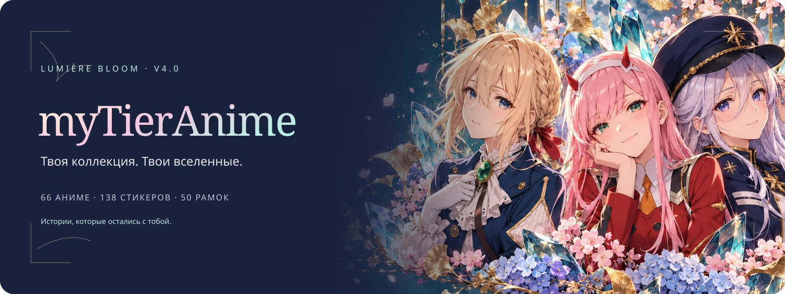

**Любимые истории заслуживают своего обрамления.**

Личная коллекция аниме: тиры, даты каждого сезона, календарь просмотров,
вечерний сад сакуры, **50 ювелирных рамок** и **102 стикера** для впечатлений: 90 героев S-тира и 12 котиков.

[**Открыть сайт ↗**](https://geraltschwarzenegger-svg.github.io/myTierAnime/)
&nbsp; · &nbsp; [Скачать офлайн-файл](https://raw.githubusercontent.com/geraltschwarzenegger-svg/myTierAnime/main/NEWAnime%20tier%20list11-08-2026.html)
&nbsp; · &nbsp; [Резервный JSON](anime-tierlist-2026-10-11.json)

---

## Что нового на сайте (Changelog)

### V3.1.0 · Sticker Stories · 17 октября 2026

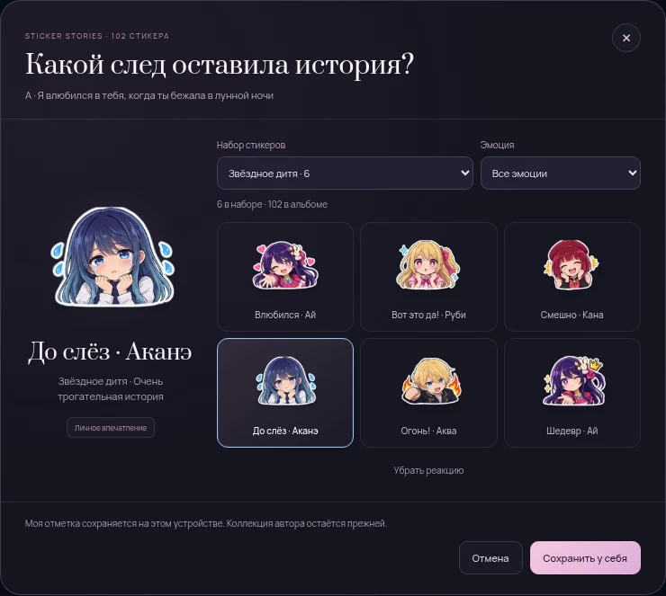

**У каждой истории теперь есть своё выражение.** Старые светящиеся значки заменены
**102 стикерами с прозрачным фоном и белым контуром**: персонажи всех 15 аниме
S-тира и оригинальные аниме-котики. Иллюстрации подготовлены специально для
этой коллекции; персонажи представлены в виде неофициального фан-арта.

| Что изменилось | Как это работает |
|:---|:---|
| **102 стикера · 16 наборов** | 90 реакций с героями S-тира — по шесть для каждого аниме — и 12 котиков. Вместо прежних пяти значков: **+1940% вариантов**. |
| **Персонажи S-тира** | Рокси, Рудеус, Сильфи и Эрис; Ай, Руби, Кана, Аканэ и Аква; Зеро Ту, Хиро и Итиго, а также герои остальных 12 историй. |
| **Навигация по альбому** | Выбор набора по аниме и фильтр эмоции. В панели видны 6 или 12 вариантов вместо длинной стены из 102 кнопок; большая иллюстрация показывает выбранную реакцию. |
| **12 настроений** | Влюбился, Шедевр, Вот это да!, Огонь!, Восхищён, Смешно, До слёз, Уютно, Есть о чём подумать, В шоке, Скучновато, Бомбит. Котики охватывают все 12; каждый аниме-набор — шесть: любовь, удивление, смех, слёзы, огонь и шедевр. |
| **Заметная отметка на постере** | Стикер расположен справа над названием. Высота подписи измеряется автоматически; у длинных названий показаны до трёх строк. Номер, дата и название остаются читаемыми. |
| **Крупнее в карточке** | Под обложкой появился отдельный блок со стикером, названием впечатления и кнопкой открытия панели. Он доступен касанием и с клавиатуры. |
| **Новая панель выбора** | 16 наборов, фильтр эмоции, большой пример, описание эмоции, отмена, сохранение и удаление реакции. Esc закрывает панель и возвращает к карточке. |
| **Для просмотренных историй** | Реакция доступна, когда у аниме есть корректная дата просмотра. В редакторе реакция без даты не сохраняется. Даты сезонов и пересмотров сохранены. |
| **Карта впечатлений** | Лента настроений над тирами: фильтры по эмоции, «Все истории» и «Без реакции». Фильтр работает вместе с поиском и избранным. Счётчики показывают число аниме. «До слёз» объединяет котиков и персонажей с такой эмоцией. |
| **Случайное воспоминание** | Выбирает просмотренное аниме среди подходящих под текущие фильтры и открывает его карточку. Можно, например, случайно вспомнить одну из уютных историй. |
| **Избранное отдельно** | Сердечко избранного и впечатление больше не зависят друг от друга. «До слёз» или «Бомбит» не добавляют аниме в любимые автоматически. Старые любимые сохранены. |
| **Моя реакция на опубликованном сайте** | Посетитель сохраняет личную отметку в своём браузере. Реакция автора и его JSON остаются прежними. Маленькая розовая точка отличает личную отметку; кнопка «Как у автора» возвращает исходное оформление. |
| **Свой список и JSON** | В редактируемой коллекции реакция сохраняется в `reaction`, избранное — в `fav`. Обычное автосохранение и экспорт JSON поддерживают все 102 варианта. Серверная проверка данных обновлена. |
| **Совместимость** | Старые ключи `heart`, `goldheart`, `bolt`, `fire`, `star` продолжают работать: они отображаются как соответствующие котики. Схема JSON остаётся 4; опубликованные 66 записей не переписаны. |
| **Микроанимации** | Стикеры мягко оживают при наведении и выборе. Режим уменьшения движения учитывается; анимации эмблем S / A / B / C сохранены. |

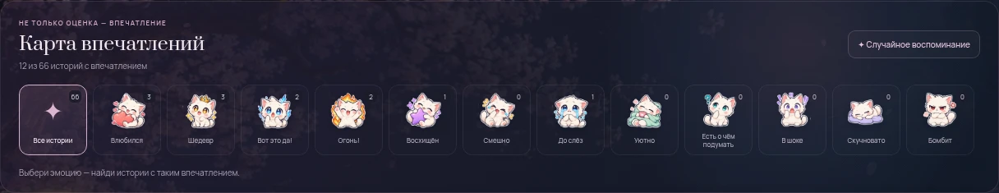

<table><tr>
<td width="50%" align="center">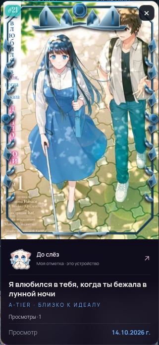 Реакция заметна под обложкой. Сезоны и даты доступны ниже.</td>
<td width="50%" align="center">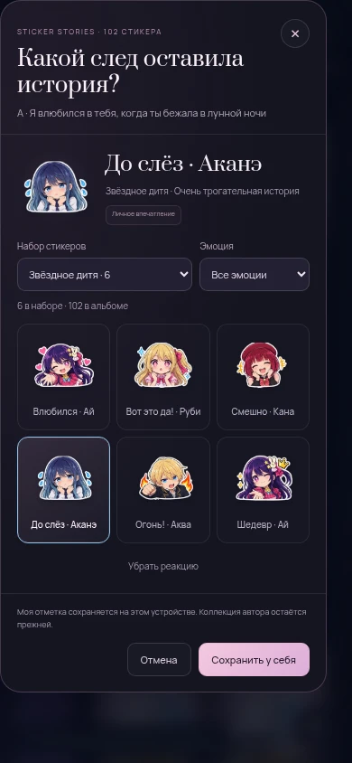 Панель на телефоне: крупный пример, выбор набора и удобная сетка.</td>
</tr></table>

**Как поставить реакцию:** открой аниме → нажми блок впечатления под обложкой →
выбери набор и стикер → сохрани. У одного аниме одна текущая реакция; её можно заменить
или убрать. Полное название доступно в открытой карточке.

**Где сохраняется выбор:** в своём списке — вместе с коллекцией и JSON;
на опубликованной чужой коллекции — как личная отметка в этом браузере.
Такие личные отметки не включаются в JSON автора и не синхронизируются между
устройствами. Если браузер запретил запись, приложение сообщает, что реакция
действует только в текущем сеансе.

<table><tr>
<td width="50%">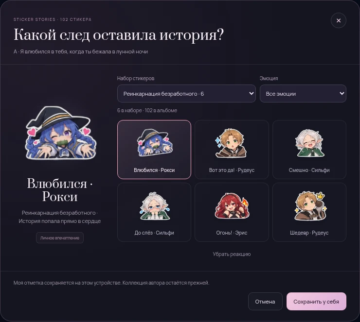 Рокси, Рудеус, Сильфи и Эрис.</td>
<td width="50%">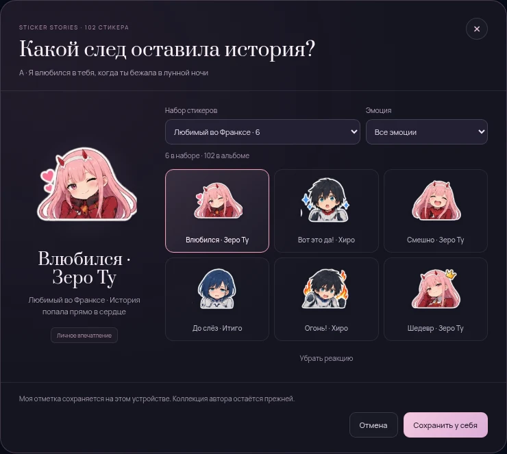 Зеро Ту, Хиро и Итиго.</td>
</tr></table>

<b>Все 15 аниме-наборов · 90 стикеров</b>

| Аниме | Персонажи набора | Стикеров |
|:---|:---|---:|
| Violet Evergarden | Вайолет | **6** |
| Атака титанов | Микаса, Эрен, Леви | **6** |
| Класс превосходства | Судзунэ, Киётака, Кэй | **6** |
| Человек-бензопила | Пауэр, Дэндзи, Аки | **6** |
| Любимый во Франксе | Зеро Ту, Хиро, Итиго | **6** |
| Адский рай | Сагири, Габимару | **6** |
| 86 | Лена, Син | **6** |
| Восхождение в тени | Альфа, Сид | **6** |
| Поднятие уровня в соло | Чха Хэин, Сон Джину | **6** |
| Фрирен | Фрирен, Ферн, Штарк | **6** |
| Школа мертвецов | Рэй, Саэко, Такаси | **6** |
| Тетрадь смерти | Миса, L, Лайт | **6** |
| Звёздное дитя | Ай, Руби, Кана, Аканэ, Аква | **6** |
| Реинкарнация безработного | Рокси, Рудеус, Сильфи, Эрис | **6** |
| Клинок, рассекающий демонов | Нэдзуко, Дзэницу, Иноскэ, Тандзиро, Синобу | **6** |

[Панель котиков](docs/images/stickers-cats.webp)

**Посмотреть иллюстрации:** [котики · 12](assets/reactions/neko-reactions.webp) ·
[S-тир · 1–5](assets/reactions/s-tier-1.webp) ·
[S-тир · 6–10](assets/reactions/s-tier-2.webp) ·
[S-тир · 11–15](assets/reactions/s-tier-3.webp).
Все четыре изображения встроены в офлайн-HTML, внешняя библиотека стикеров не нужна.

**О цифрах:** +1940% — измеримый рост числа вариантов реакции с 5 до 102.
Число настроений выросло с 5 до 12 (**+140%**). Процент «качества» не приписывается:
читаемость и удобство проверяются в работающем интерфейсе.

При проектировании учтены [стикеры Telegram](https://core.telegram.org/stickers),
[доступные диалоги WAI-ARIA](https://www.w3.org/WAI/ARIA/apg/patterns/dialog-modal/)
и [системное уменьшение движения](https://developer.mozilla.org/en-US/docs/Web/CSS/@media/prefers-reduced-motion).

### V3.0.2 · Анимации эмблем возвращены · 16 октября 2026

- «Форма голоса» перенесена из C в **B**. Дата 11.03.2026, обложка, ID и остальные поля сохранены; оба JSON синхронизированы.
- Возвращены анимации букв и эффектов S / A / B / C: сияние, призма, тушь и сакура. Сами боковые плашки остаются на месте и не следуют за прокруткой.
- В «Эффектах» снова доступен переключатель **«Анимация букв S / A / B / C»**. Прежнее принудительное отключение исправляется при первом запуске обновления, последующий выбор пользователя сохраняется.
- Кнопка **«Включить движение и проверить»** действительно проверяет смену кадров. Режим без движения и системное уменьшение движения учитываются.
- Текущая коллекция: **S — 15, A — 21, B — 16, C — 14; всего 66 аниме и 76 записей просмотра**.

### V3.0.1 · Исправлена обложка · 16 октября 2026

Для «Я влюбился в тебя, когда ты бежала в лунной ночи» установлена выбранная
владельцем обложка с синим платьем и белой тростью. Предыдущая иллюстрация
заменена в карточке, ателье и встроенном офлайн-изображении. Оба JSON используют
новый адрес обложки; старые сохранения с прежним адресом тоже показывают её.
Тир A и дата 14.10.2026 сохранены. Скриншоты обновлены.

[Выбранная обложка](assets/covers/love-unseen-selected-cover.jpg) ·
[Увеличенная копия 4K](assets/covers/love-unseen-selected-cover-4k.jpg)

### V3.0 · Jewel Atelier · 16 октября 2026

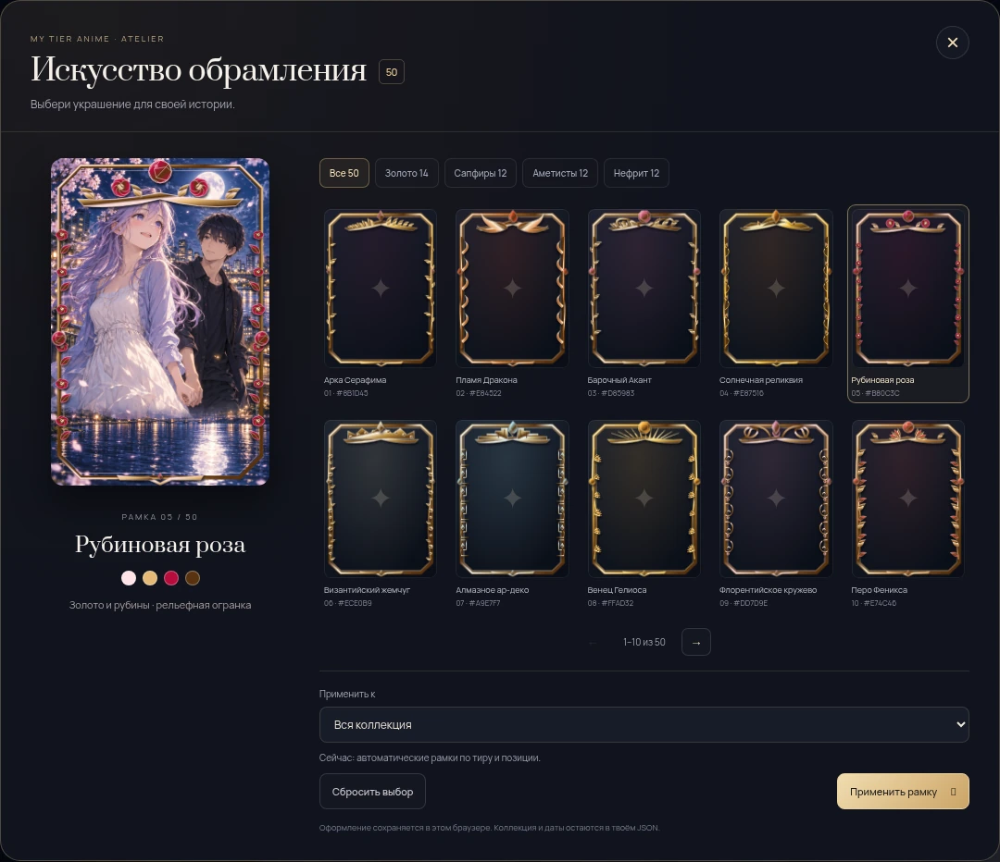

*Скриншот работающего интерфейса: «Рубиновая роза» показана на постере.
Это пример оформления; применение происходит отдельной кнопкой.*

| Обновление | Что именно улучшилось |
|:---|:---|
| **50 рамок вместо 16** | 34 новые модели: розы, крупные листья, крылья, веера, витые ветви, геральдика, соборы, созвездия и геометрия ар-деко. У каждой модели собственная палитра и форма верхнего узора. |
| **Ювелирные материалы** | Рубины, сапфиры, алмазы, аметисты, нефрит, изумруды, гранаты, оникс и жемчуг. Пять форм камней: ромб, капля, восьмигранник, маркиз и круглая огранка. |
| **Ателье рамок** | Новая кнопка **«✦ Рамки 50»** в инструментах. Каталог по 10 вариантов на странице, фильтры по материалам, большой пример на постере, название и цвета выбранной рамки. |
| **Своя рамка для каждого аниме** | Можно оформить один тайтл или всю коллекцию. Выбор сохраняется после перезагрузки; **«Сбросить выбор»** возвращает автоматическое оформление. |
| **Положение боковых плашек** | Плашки не следуют за прокруткой и не наклоняются от курсора. Анимации букв и украшений внутри них возвращены в V3.0.2. |
| **Крупнее и выразительнее** | Расширены верхние узоры, боковые украшения и огранённые камни. В увеличенной карточке повторяется выбранная рамка. Название, реакции, даты и кнопка закрытия расположены поверх декора. |
| **Новое аниме в A** | **«Я влюбился в тебя, когда ты бежала в лунной ночи»**, просмотр **14.10.2026**. Установлена выбранная владельцем обложка; добавлены название, JPG, `uid`, `fav`, `reaction` и запись просмотра. |
| **Синхронные JSON** | `data.json` и резервный снимок содержат одинаковые 66 аниме и 76 записей просмотра. Старые тайтлы, даты, реакции и порядок сохранены; `nextUid` увеличен до 69. |
| **Версия на странице** | В самом конце сайта справа размещены **V3.0**, название обновления и дата выпуска. Версия приложения отделена от версии схемы JSON. |
| **Компактный каталог** | Рамки строятся локально из SVG. Одновременно отображается до 10 вариантов; при закрытии каталога его декоративные элементы освобождаются. Для рамок не нужны сторонние изображения или библиотеки. |
| **Новая документация** | Подробный Changelog, реальные скриншоты, актуальные количества, инструкция ателье и описание сохранения. |

**Измеримые изменения относительно предыдущего опубликованного состояния:**

| Показатель | Было | Стало | Прирост |
|:---|---:|---:|---:|
| Модели рамок | 16 | **50** | **+212,5%** · в 3,125 раза больше |
| Аниме | 65 | **66** | **+1,54%** |
| Записи просмотра | 75 | **76** | **+1,33%** |
| Новые модели рамок | — | **34** | 68% текущего каталога |

Проценты рассчитаны по количеству. Визуальное качество не имеет объективной
процентной шкалы: изменения можно оценить по скриншотам и на самом сайте.

### Предыдущие обновления · октябрь 2026

| Область | Что уже доступно |
|:---|:---|
| Главная | Большой кадр с героями, статистика, последние просмотры и навигация к коллекции, календарю и альбому. |
| Атмосфера | Встроенная большая сакура, вечерний сад, другие фоновые сцены и собственная фотография. |
| Коллекция | Постеры или чипы, поиск, избранное, реакции, размер постеров от 94 до 190 px и перенос между тирами в редакторе. |
| Превью | Клик или касание вместо наведения. Окно остаётся открытым; длинная история сезонов прокручивается. |
| S-тир | Золотые акценты, короны, выразительная отметка «Элита» и отдельное оформление шедевров. |
| Эффект карточки | Мягкое послесвечение, блик и световые частицы заменили прежние когти. |
| Даты | Компактная «Моя дата», ручная отметка или автоматическая дата визита, календарь по месяцам и поиск истории. |
| Альбом | Статичные иллюстрации героев, пар и дуэтов 15 аниме S-тира; четыре портрета из «Звёздного дитя» без подписей с именами. |
| Сохранение | Последовательная запись зеркал, защита от запоздалого шифрования, резервный JSON и сообщения об ошибках хранения. |

## ✦ Ателье рамок

1. Нажми **«✦ Рамки 50»** рядом с инструментами коллекции.
2. Выбери материал и полистай каталог. Нажатие на вариант меняет большой пример.
3. В поле **«Применить к»** оставь всю коллекцию или выбери конкретное аниме.
4. Нажми **«Применить рамку»**. Оформление появится на постере и в его превью.

| Семейство | Моделей | Характер |
|:---|---:|:---|
| **Золото и рубины** | **14** | Имперские оправы, розы, гранаты, жемчуг, алмазное ар-деко и золотая геральдика. |
| **Сапфиры и лёд** | **12** | Серебро, ледяные крылья, бастионы, аквамарин и ночные созвездия. |
| **Аметисты и ночь** | **12** | Тернии, обсидиановые розы, астральные печати, перья и тёмные шпили. |
| **Нефрит и жемчуг** | **12** | Лотосы, бамбук, листья гинкго, малахитовые лозы, перламутр и осенний клён. |

Без ручного выбора модели распределяются по тиру и позиции: S — золотые,
A — сапфировые, B — аметистовые, C — нефритовые. В нынешней коллекции
автоматически представлены все 50 моделей. Любую рамку можно выбрать
для любого тира; перенос аниме не отменяет его личный выбор.

**Как сохраняется оформление.** Ателье запоминает предпочтения в этом браузере
отдельно от аниме. Общая рамка заменяет индивидуальные назначения; после этого
можно снова настроить отдельные тайтлы. Сброс всей коллекции возвращает
автоматические рамки, сброс одного аниме — общее оформление.
Рамки не переносятся через JSON и не публикуются автоматически для других
посетителей. Если браузер запретил запись, ателье сообщит, что выбор действует
только в текущем сеансе.

<b>Все 50 названий</b>

| Золото и рубины · 14 | Сапфиры и лёд · 12 | Аметисты и ночь · 12 | Нефрит и жемчуг · 12 |
|:---|:---|:---|:---|
| Арка Серафима | Сапфировый компас | Корона терний | Корни Иггдрасиля |
| Пламя Дракона | Крылья Валькирии | Аметистовый жнец | Нефритовый лотос |
| Барочный Акант | Кристальный бастион | Эфирный плющ | Изумрудный страж |
| Солнечная реликвия | Звёздное копьё | Рунный осколок | Роса светлячков |
| Рубиновая роза | Ледяной грифон | Обсидиановая роза | Золотой гинкго |
| Византийский жемчуг | Аквамариновый прилив | Крылья Ноктюрна | Бамбуковый дворец |
| Алмазное ар-деко | Карта созвездий | Печать Архимага | Пруд белых лотосов |
| Венец Гелиоса | Северная звезда | Шпиль оникса | Нефритовые облака |
| Флорентийское кружево | Собор морозов | Венец затмения | Малахитовая лоза |
| Перо Феникса | Серебряная волна | Эфирное перо | Императорская хризантема |
| Геральдический лев | Призматический портал | Ночной цикламен | Перламутровая раковина |
| Гранатовый собор | Сапфировый полумесяц | Астральный змей | Осенний момидзи |
| Лунная лилия | | | |
| Золотой Уроборос | | | |

<table><tr>
<td width="50%" align="center">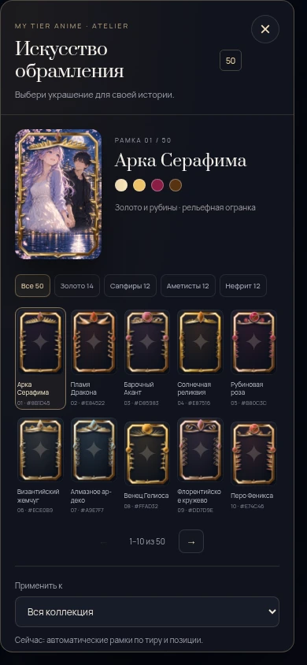 Ателье адаптируется к узкому экрану; каталог и настройки прокручиваются.</td>
<td width="50%" align="center">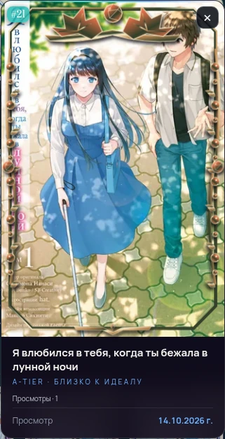 Новая история в A. Здесь применена рамка «Осенний момидзи».</td>
</tr></table>

## ✦ Новая история под лунным небом

**Я влюбился в тебя, когда ты бежала в лунной ночи** 
**A · 14.10.2026 · uid 68**

Установлена выбранная владельцем обложка первого тома: герои на солнечной
дорожке, синее платье и белая трость. Исходный JPG **333 × 500** сохранён
без изменений и встроен в HTML, чтобы работать без сети.

Отдельно подготовлена увеличенная копия **2560 × 3840** с восстановлением
изображения. Она предназначена для скачивания; мелкие детали и надписи могут
отличаться от оригинала. На сайте используется исходная выбранная обложка.

[**Открыть выбранную обложку ↗**](assets/covers/love-unseen-selected-cover.jpg)
&nbsp; · &nbsp; [Скачать увеличенную копию 4K](assets/covers/love-unseen-selected-cover-4k.jpg)
&nbsp; · &nbsp; [Источники изображений](assets/covers/README.md)

## ✦ Даты, которые складываются в историю

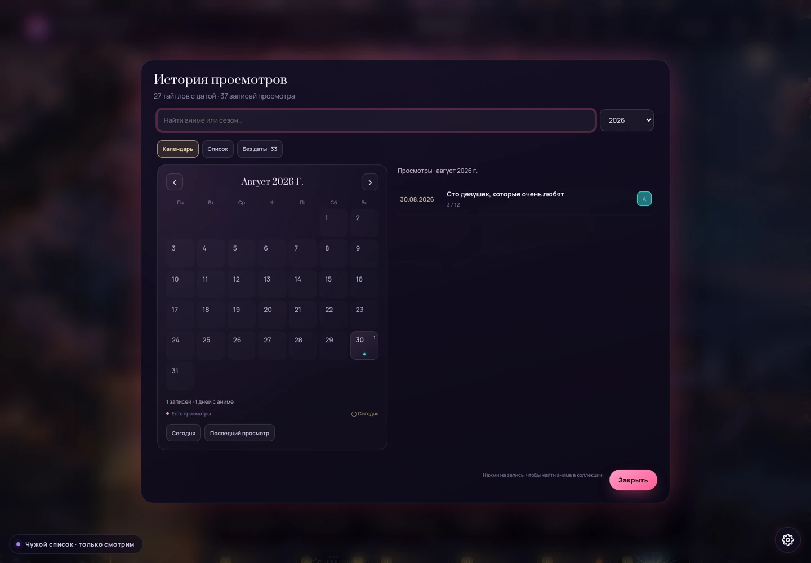

- **Месяц целиком:** неделя начинается с понедельника, сегодня выделено, у дней есть счётчик просмотров.
- **День подробнее:** нажми дату, чтобы увидеть аниме, сезоны и пересмотры; из списка можно выделить их в коллекции.
- **Несколько сезонов:** у каждого аниме хранится список записей с подписью и датой; в превью он прокручивается.
- **Личная отметка:** компактная «Моя дата» принимает ручную дату или автоматически показывает текущий визит.

Карточка открывается **кликом, касанием или Enter**, закрывается повторным
нажатием, кнопкой ×, нажатием снаружи или Esc. В режиме редактирования
нажатие открывает редактор аниме. История дат остаётся доступной при выборе рамки.

## ✦ Атмосфера и анимации

**Плашки остаются на месте, буквы и эффекты внутри них анимируются.**
В «Стихиях» у S раскрываются лучи сияния, у A переливаются грани призмы,
у B проявляются мазки туши, у C покачивается ветка сакуры и падают лепестки.
Также доступны «Орбиты 3D» и «Классика». В «Эффектах» движение букв
управляется отдельным переключателем; его выбор сохраняется в браузере.

Стикеры приветствуют короткой анимацией при наведении и выборе;
системное уменьшение движения отключает её.

В **Эффектах** отдельно настраиваются фоновые частицы, лепестки, свечение,
послесвечение и наклон карточек. **Авто** учитывает системное уменьшение
движения; **Без движения** оставляет статичный интерфейс. Если нужен покой
и на постерах, отключи **«Блик и наклон карточек»** и **«Живой неон по контурам»**.
Рельефные рамки можно полностью скрыть отдельным переключателем.

Сакура и альбом встроены в HTML. Собственная фотография фона сохраняет
приоритет. Декоративные эффекты приостанавливаются вне экрана и в фоновой
вкладке; при PNG-экспорте рамки сохраняются в статичном виде.

## ✦ Альбом шедевров

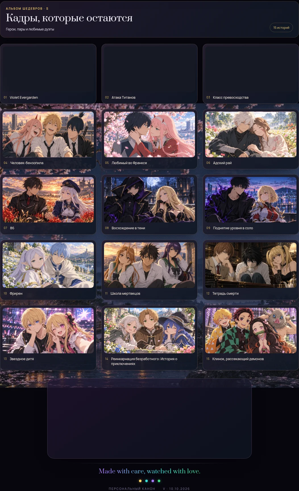

**15 аниме · 15 отдельных иллюстраций · одна коллекция впечатлений.**

Внизу страницы — статичный альбом главных героев, пар и дуэтов нынешнего
S-тира. Нажми кадр, чтобы рассмотреть его крупнее; стрелки перелистывают альбом.
Четыре портрета из «Звёздного дитя» сохранены отдельной композицией без подписей
с именами. Альбом и подпись внизу не анимируются.

Иллюстрации созданы с помощью генерации изображений. Состав альбома подготовлен
для текущих 15 аниме S и не перестраивается автоматически при переносе тайтлов.

## ✦ Начать за минуту

1. **Открой [сайт](https://geraltschwarzenegger-svg.github.io/myTierAnime/)** или скачай [единый HTML](https://raw.githubusercontent.com/geraltschwarzenegger-svg/myTierAnime/main/NEWAnime%20tier%20list11-08-2026.html).
2. **Для своего списка** используй редактор и импорт через **Хранилище → Импорт**. Опубликованный список владельца показывается гостям для чтения.
3. **Настрой оформление:** кнопка «Рамки 50», панель эффектов, размер карточек и фон.
4. **Сохрани JSON-копию:** она переносит аниме, порядок, реакции и даты на другое устройство.

Шрифты, фон, альбом, новая обложка и библиотека PNG-экспорта встроены
в офлайн-файл. Для остальных внешних обложек и сетевых функций нужен интернет.

## ✦ Данные остаются у тебя

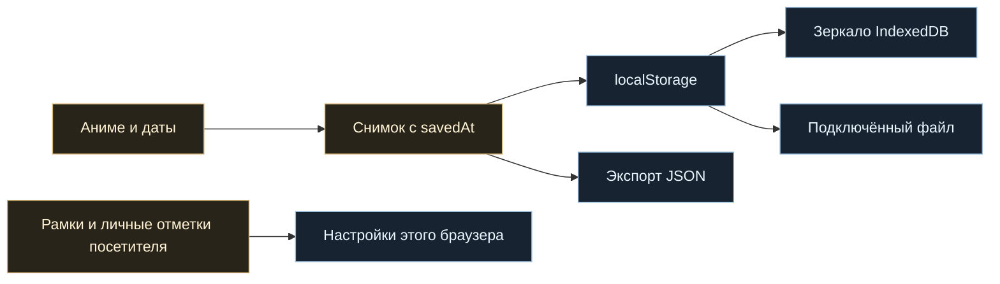

Незашифрованные правки записываются в localStorage сразу. Зеркала обновляются
последовательно; если подключён файл-хранилище и браузер разрешает запись,
в него отправляется тот же снимок. При включённом пароле снимок шифруется
перед сохранением. Запоздалое шифрование не затирает более свежую правку.
Индикатор сообщает об ошибках хранения.

Автосохранение относится к текущему браузеру и адресу сайта. Очистка данных
браузера может удалить коллекцию и оформление, поэтому отдельная JSON-копия
остаётся полезной. Локальное сохранение и публикация — разные действия.
Рамки и другие визуальные предпочтения в JSON коллекции не включаются.
Стикерная реакция своего списка (`reaction`) и избранное (`fav`) включаются;
личные отметки посетителя опубликованного списка хранятся отдельно в браузере.

| Снимок · актуализирован 16.10.2026 | S | A | B | C | Аниме | Просмотры |
|:---|---:|---:|---:|---:|---:|---:|
| [data.json](data.json) | 15 | **21** | **16** | **14** | **66** | **76** |
| [anime-tierlist-2026-10-11.json](anime-tierlist-2026-10-11.json) | 15 | **21** | **16** | **14** | **66** | **76** |

Содержимое снимков одинаково; имя резервного файла сохранено по предыдущему
запросу. В новой записи точная дата **14.10.2026**, подпись просмотра пустая,
`fav: false`, `reaction: null`. Примерные даты прежних записей сохраняют
свои пометки. [История заполнения дат](docs/watch-dates-2026.md).

## ✦ Безопасность и проверка

| Текущий сайт на GitHub Pages | Подготовленная серверная версия |
|:---|:---|
| CSP с хешами встроенных скриптов; библиотека PNG проверяется SRI. | Cloudflare Workers + D1, вход по коду на почту, отзыв сессии при выходе. |
| URL изображений и импорт проверяются перед отображением. | Проверки владельца, Origin, частоты запросов, размера и схемы данных. |
| Опубликованный `data.json` доступен для чтения. | Для публикации сервера нужны отдельная конфигурация и отправка почты. |

Локальный пароль использует **PBKDF2-SHA256** и **AES-GCM-256**.
Пароль не восстанавливается и не скрывает уже опубликованный публичный JSON.
Подробности — в [SECURITY.md](SECURITY.md), серверная инструкция —
в [site/README.md](site/README.md).

Для V3.0 проверяются уникальность всех 50 форм и ссылок SVG, соответствие
постера и превью, сохранение индивидуального и общего выбора, сброс,
движение букв внутри неподвижных плашек, узкие экраны, история сезонов, JSON и автосохранение.
Скриншоты выше получены из приложения в Chromium.

<b>Визуальные источники и оригинальные иллюстрации</b>

- [Telegram · Stickers](https://core.telegram.org/stickers): узнаваемые силуэты и прозрачные стикеры.
- [Telegram · Animated Stickers](https://telegram.org/blog/animated-stickers): выразительность небольших реакций.
- [WAI · Modal Dialog](https://www.w3.org/WAI/ARIA/apg/patterns/dialog-modal/): клавиатура, фокус и закрытие панели.
- [MDN · prefers-reduced-motion](https://developer.mozilla.org/en-US/docs/Web/CSS/@media/prefers-reduced-motion): учёт настроек движения.
- [V&A · Art Nouveau](https://www.vam.ac.uk/collections/art-nouveau): растительные формы, вьющиеся линии и ювелирные мотивы.
- [V&A · Art Deco](https://www.vam.ac.uk/collections/art-deco): геометрия, симметрия и декоративные ступенчатые композиции.
- [Официальный сайт Love Unseen Beneath the Clear Night Sky](https://sh-anime.shochiku.co.jp/kakekoi/): информация об аниме.

Рамки нарисованы программно для проекта. Графические ассеты из музейных
коллекций и игровых референсов не копировались. Выбранная обложка принадлежит
правообладателям произведения; альбом — сгенерированный фан-арт. Увеличенная
копия обложки обработана отдельно и не заменяет исходник на сайте.

---

myTierAnime · <b>V3.1.0 — Sticker Stories</b> · 17.10.2026

