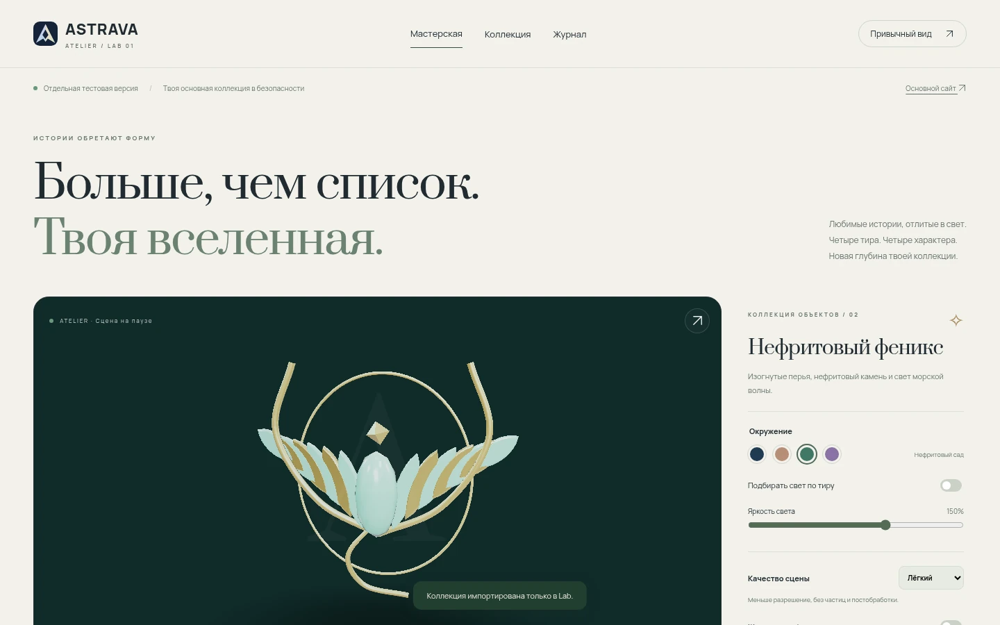
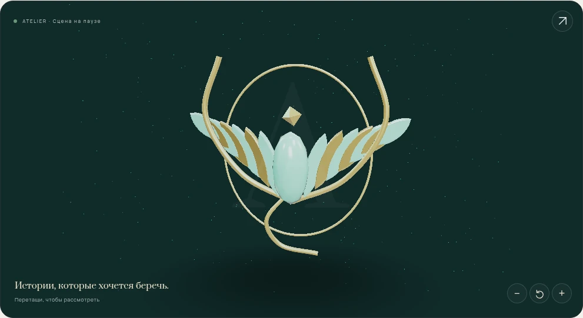
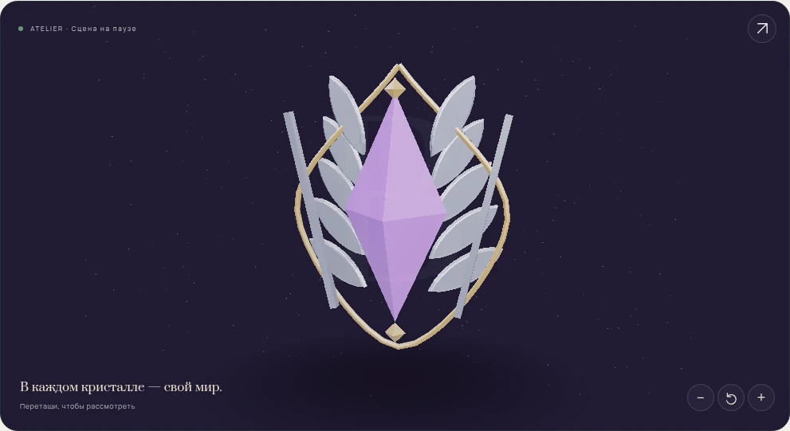
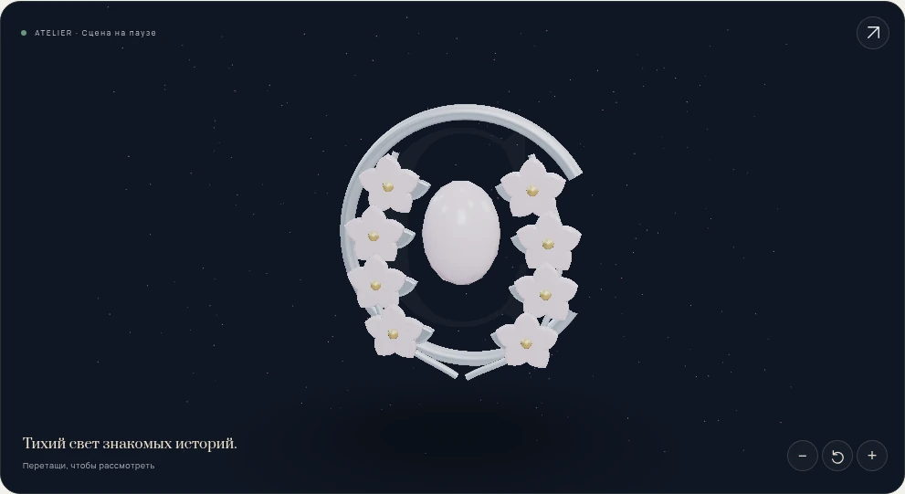
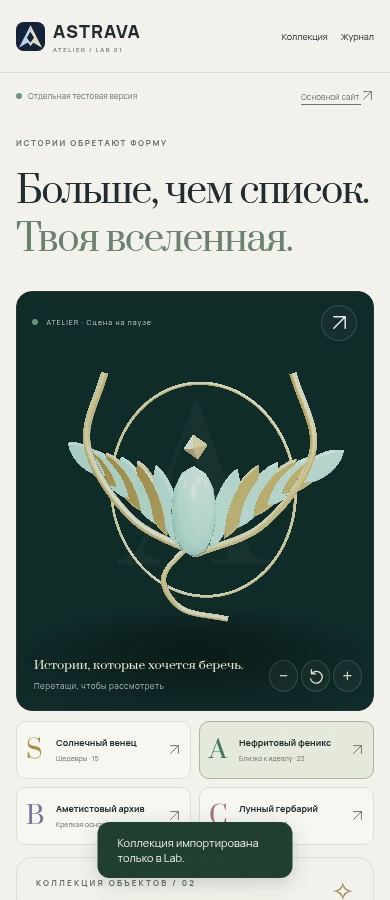

# ASTRAVA Lab · Atelier 01

**У каждой истории есть своя форма.**

Отдельная мастерская новой графики для [ASTRAVA](https://geraltschwarzenegger-svg.github.io/myTierAnime/): четыре объёмные эмблемы, спокойное светлое оформление и вся коллекция из 69 аниме.

Основной сайт остаётся на **V5.0.0**. Эта лаборатория не заменяет его. Отдельный публичный Pages-адрес пока не создан: GitHub-доступ не разрешает создание нового репозитория (HTTP 403). Исходники и готовый тест находятся только в ветке `astrava-lab-01`.

[Скачать готовый тест · ZIP](https://raw.githubusercontent.com/geraltschwarzenegger-svg/myTierAnime/astrava-lab-01/lab/downloads/ASTRAVA-Lab-test.zip) · [План и выбор технологий](docs/PLAN.md) · [Проверки и ограничения](docs/QA.md)



## Что можно попробовать

| Возможность | Что работает |
|---|---|
| Четыре эмблемы | S — солнечный венец; A — нефритовый феникс; B — аметистовый архив; C — лунный гербарий |
| Настоящее 3D | Геометрия, физические материалы, студийное освещение, вращение перетаскиванием и стрелками |
| Окружение | Звёздный зал, тёплый рассвет, нефритовый сад, лунная ночь; автоматическая связь с тиром или ручной выбор |
| Управление | Приближение кнопками, сброс, PNG кадра, общая пауза и необязательное медленное вращение |
| Модели | Скачивание GLB и открытие своей самодостаточной GLB до 20 МБ, без отправки файла на сервер |
| Коллекция | Все 69 аниме, локальные постеры, фильтры, поиск и избранное |
| Просмотры | Несколько дат, редактирование подписей/минут, общий хронометраж и календарь по месяцам |
| Сохранения | Собственная тестовая копия, импорт и экспорт JSON; исходные записи не перезаписываются |
| Привычные функции | Полная отдельная копия V5 через «Привычный вид»; её сохранения тоже изолированы |
| Производительность | Одна сцена, 2–3 меша на эмблему, три режима качества и остановка движения по условиям |

<details>
<summary>Посмотреть другие эмблемы и мобильный вид</summary>







</details>

## Почему TypeScript, а не полная перепись на Rust

Для интерфейса используется HTML/CSS и строгий TypeScript. Three.js управляет WebGL 2, а небольшие GLSL-шейдеры — частицами и мягкой тенью. Vite собирает независимые модули. GLB — переносимый формат модели, который можно открыть в Blender.

**Rust и WebGPU в эту реализацию не включены.** Пока не найден и не измерен участок CPU, который оправдывает Rust/WebAssembly. Сам язык не добавляет детализацию моделям и не заменяет работу с материалами и светом. Полный разбор с официальными источниками — в [плане](docs/PLAN.md).

## Как защищены основные сохранения

GitHub Pages разных репозиториев одного пользователя разделяют origin. Поэтому разный адрес не считается достаточной изоляцией:

- Новый UI использует `astrava-lab:v1:*`.
- Копия V5 получает префикс `astrava-lab:classic:*` для localStorage, sessionStorage и IndexedDB.
- Данные основного сайта не импортируются из его браузерных хранилищ автоматически.
- Изменения не отправляются в основной GitHub-репозиторий. В лаборатории нет функции публикации в него.
- Импорт JSON проверяется до замены тестовой коллекции. Неудачный импорт не перезаписывает её.

Исходная копия привязана к коммиту `b497ec0` основного проекта; контрольные суммы — в [baseline.json](docs/baseline.json).

## Готовый тест без установки

Скачай ZIP по ссылке выше, распакуй и открой `ASTRAVA-Lab.html`. В архиве также есть изолированная автономная копия V5 и `collection.json` для неё. Обложки, шрифты и код новой лаборатории встроены в HTML.

В управляемой среде прямая навигация `file://` запрещена политикой браузера. Самодостаточность проверена через перехваченный HTTPS-origin с блокировкой остальных запросов. Обычная серверная сборка проверена непосредственно в Chromium.

## Локальный запуск

Нужен Node.js 24+.

```sh
cd lab
npm ci
npm run dev
```

Проверки и сборка:

```sh
npm test
npm run models
npm run build
npm run preview
```

Открыть `http://localhost:4173/`. Файл `.github/workflows/pages.yml` внутри лаборатории — шаблон публикации для будущего отдельного репозитория; в тестовой ветке основного проекта он не запускается. `dist/index.html` нужно запускать через HTTP-сервер, а не двойным щелчком `file://`.

Для браузерных проверок:

```sh
npx playwright install chromium
npm run test:browser
```

Если системного `/usr/bin/chromium` нет, тест использует Chromium из Playwright. Другой системный путь задаётся через `CHROMIUM_EXECUTABLE`. Проверка опубликованного адреса: `LAB_URL=https://.../ npm run test:browser`. Все пользовательские изменения при проверке остаются в временном браузерном профиле.

## Структура

```text
src/data.ts       — проверка JSON, хронометраж, изолированное хранилище
src/models.ts     — четыре оригинальные процедурные 3D-эмблемы
src/scene.ts      — камера, материалы, свет, качество, жизненный цикл GPU
src/glb.ts        — предварительная проверка входящего GLB
src/main.ts       — галерея, настройки, календарь, просмотр и редактор
public/classic/   — автономная тестовая копия интерфейса V5
public/models/    — четыре готовых GLB и статические изображения
scripts/          — экспорт моделей и подготовка копии исходных ресурсов
```

## Ограничения

Это лаборатория эмблем, а не завершённая миграция всех функций V5. Старые реакции, альбом и полное ателье рамок доступны в режиме совместимости. Настройки нового и привычного интерфейса независимы.

Открытая пользователем GLB живёт в памяти вкладки до перезагрузки. Четыре штатные эмблемы создаются программно; это не модели персонажей из Blender. Результаты FPS зависят от устройства. Если WebGL 2 недоступен, остаётся статическое изображение и рабочая коллекция.

Зависимости и происхождение ресурсов: [THIRD_PARTY.md](THIRD_PARTY.md).
